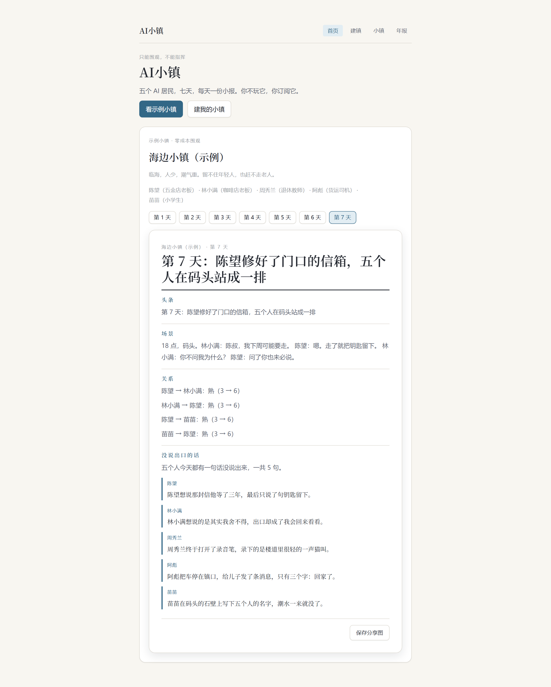

# AI小镇

一个**只能围观、不能指挥**的 AI 小镇：5 个居民，7 天，每天一份小报。你不玩它，你订阅它。

- 在线 Demo：https://preview.ai-town-5ts.pages.dev
- 图文教程：[docs/showcase/tutorial.html](docs/showcase/tutorial.html)（[PDF 版](AI小镇-图文教程.pdf)）
- 示例镇零配置可看；要开自己的小镇，只需在页面里填自己的模型 API Key
- 数据只存在浏览器本地；服务端不持久化居民设定、记忆与剧情正文



## 能做什么

- **看示例镇**：内置海边小镇 7 天完整小报，断网可看，模型调用为 0
- **建自己的镇**：海边小镇 / 大学城后街 / 老城区拆迁楼三套模板，5 个居民可改
- **推进一天**：填自己的模型 Key，点「过一天」，看计划、相遇、对话、关系与小报
- **投递外部事件**：每天最多 1 条，只描述外部发生的事，不能指挥居民
- **留下痕迹**：关系图、分享长图、导出 `town.json` / `town.md`，JSON 可回导续玩
- **本地优先**：IndexedDB 存储；隐私模式不可用时降级到内存并提示

## 本地跑起来

要求：Node.js 20+、npm。

```bash
npm install
npm run dev
```

打开 http://127.0.0.1:4173 。

- 只想看效果：直接看首页的「示例小镇」，不需要任何 Key
- 想自己开一局：进入「建镇」→ 开始 → 在「小镇」页填入自己的 DeepSeek / OpenAI 兼容 API Key
- Key 只用于换取 2 小时会话，不写入本地存储；不填 Key 时使用本地桩模型，不消耗额度

## 常用脚本

| 命令 | 作用 |
|---|---|
| `npm run dev` | 启动静态服务 + 函数本地运行时 + 本地 KV |
| `npm run test:unit` | 单元测试 |
| `npm run test:contract` | 契约与快照测试 |
| `npm run test:integration` | 集成测试（桩模型 / 本地 KV） |
| `npm run test:e2e` | Playwright 端到端 |
| `npm run smoke` | 本地冒烟 |
| `npm run smoke:remote` | 远端冒烟（需要 `BASE_URL`） |
| `npm run deploy:preview` | 发布到 Cloudflare Pages + Workers preview |

真实模型七天用例：

```bash
E2E_REMOTE=1 E2E_BASE_URL=https://preview.ai-town-5ts.pages.dev \
  npm run test:e2e -- --grep "seven-days"
```

需要本地 `.env.local` 中存在 `DEEPSEEK_API_KEY`（已 gitignore，不会进仓库）。

## 目录结构

```text
web/            无构建前端：app / domain / infra / ui / styles
functions/      Cloudflare Workers 函数：health、session、templates、tick、events
shared/         前后端共享的契约、错误码与工具
data/           三套模板 + 7 天示例镇数据
scripts/        本地开发、测试、部署、冒烟、指标
tests/          unit / contract / integration / e2e
docs/           spcd.md、task.md、data.md、showcase 图文教程
```

## 部署

静态与函数分开发布，浏览器只访问 Pages 域名，`/v1/*` 由 Pages Functions 反向代理到 Worker。

```bash
# 1. 准备 Cloudflare 项目与 KV
#    - Pages 项目名写入 CF_PAGES_PROJECT
#    - 两个 KV namespace id 写入 wrangler.toml（preview / production）
#    - MODEL_BASE_URL、MODEL_NAME 写入环境变量
#    - CLOUDFLARE_API_TOKEN，或先执行 npx wrangler login

# 2. 发布
npm run deploy:preview
```

部署脚本会把 `web/`、`data/`、`shared/` 组装成静态目录后上传，避免线上请求 `/data` 或 `/shared` 时回落到 `index.html`。

## 测试与指标

最近一次验证：

- 单元 92 条、集成 61 条、契约 52 条全部通过
- 真实模型 3 局 × 7 天连续通过：P95 13.1 秒，单轮最高成本 0.05 元
- 远端 `smoke:remote` 通过

## 说明

- 小镇、居民、记忆、剧情全部保存在浏览器；清浏览器数据即失去小镇
- 服务端只在边缘 KV 保存短 TTL 运行态（tick 占位、限流、幂等键、续传快照），不含剧情正文
- 本项目为作品提交与演示用途；模板文案与示例镇剧情均为虚构
