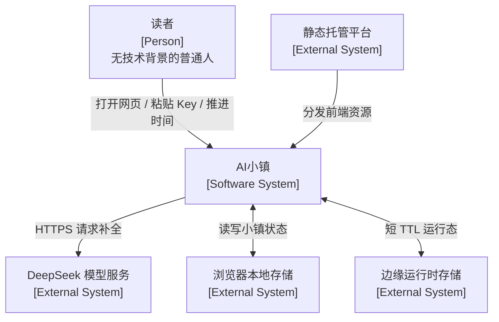
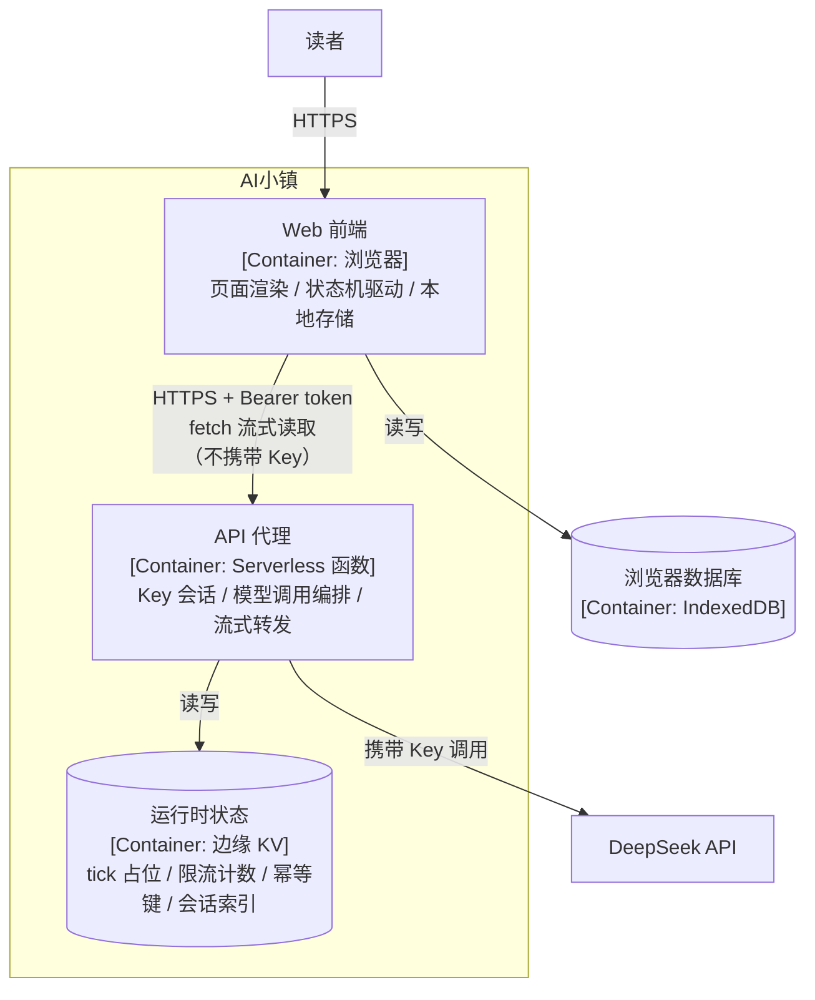
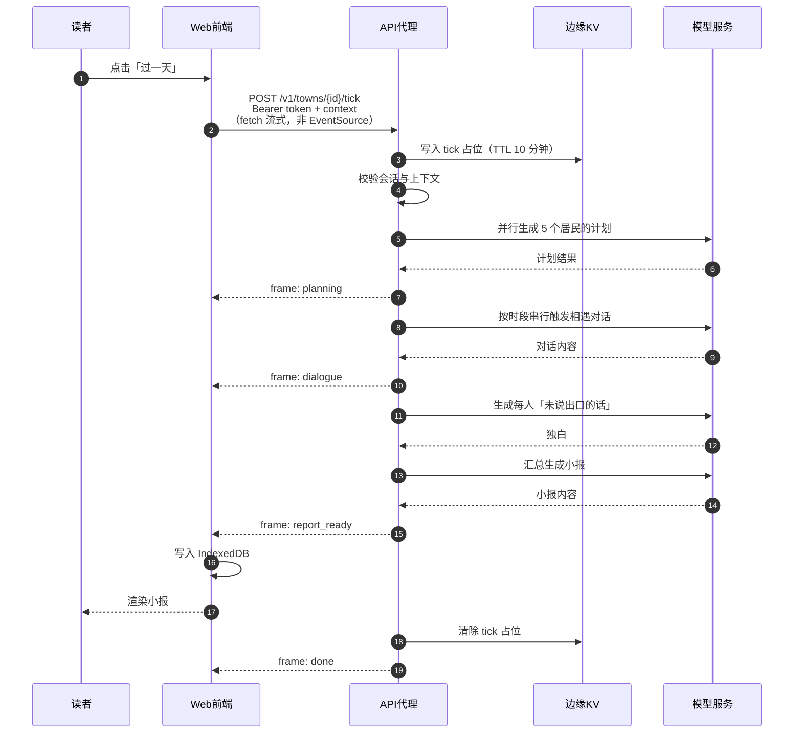
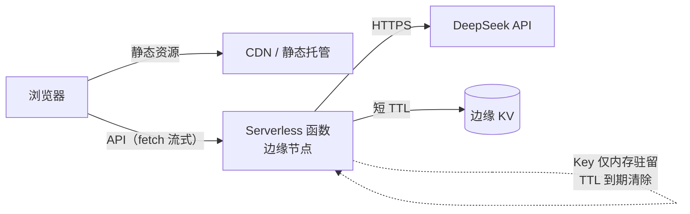
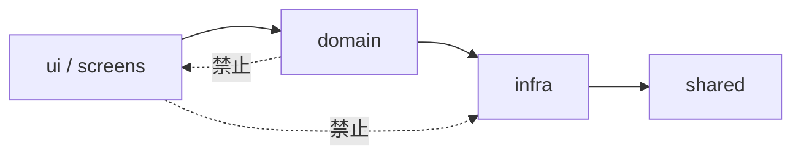
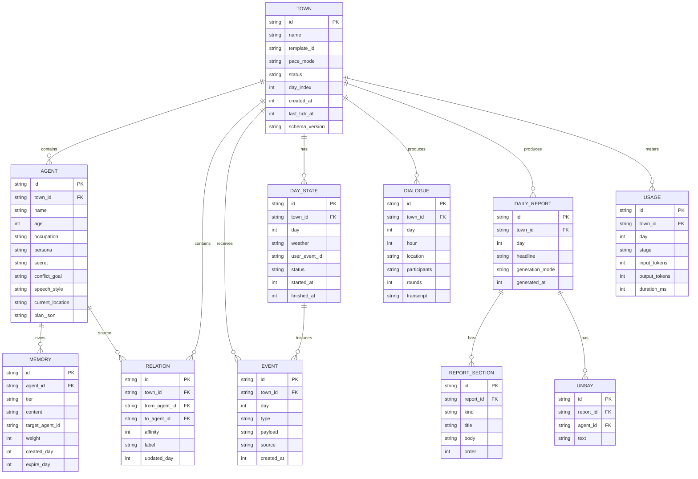
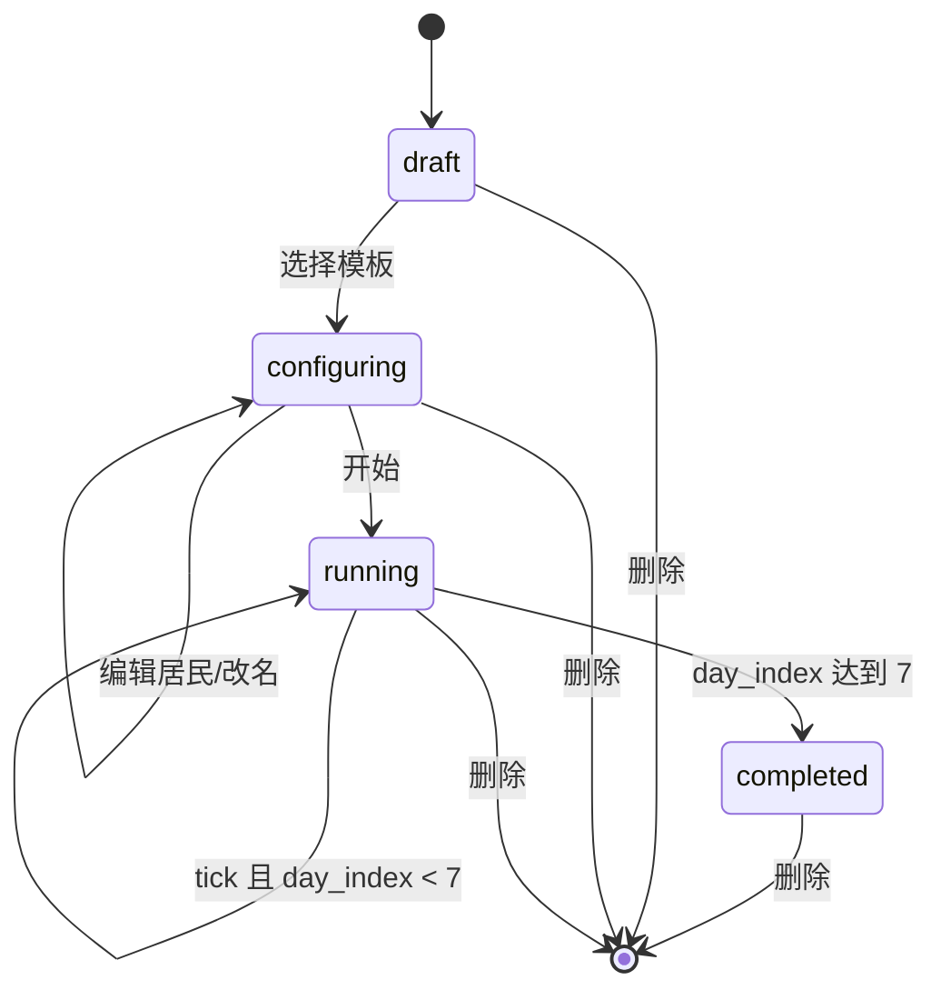
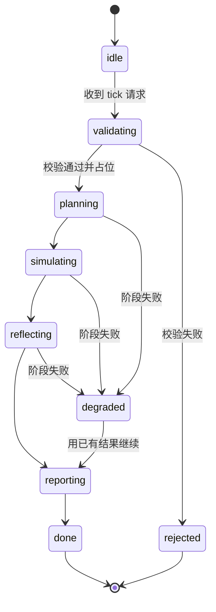
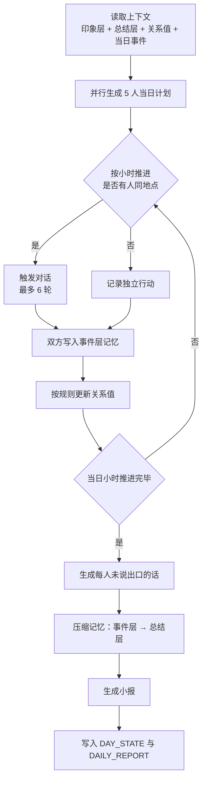
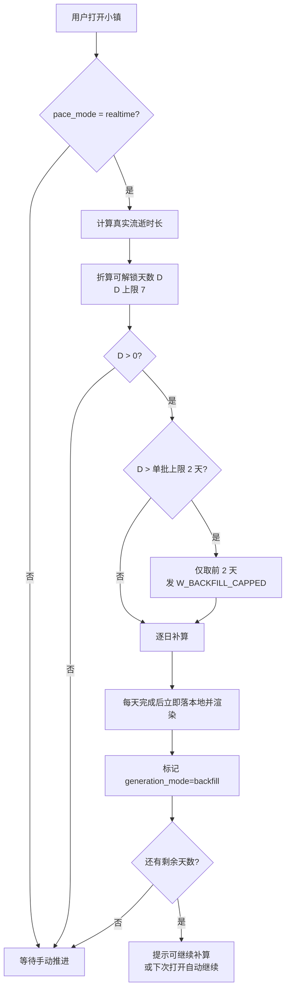

# AI小镇 · SPCD（软件产品设计契约）

> 版本 v1.2 ｜ 2026-11-12 ｜ 状态：已实现（preview 部署待外部凭据）
> 上游文档：`AI小镇-项目一页纸.md`
> 本文档面向：需要从零复现本项目的工程师
> v1.1 修订：修复 SSE 鉴权矛盾、补齐 Tick 上下文契约、引入最小运行时状态层、删除与服务端形态冲突的端点与字段
> v1.2 修订：三套模板定稿（Q3 关闭）、补齐模板端点说明与目录地图、回写实现偏差（见附录 C）

---

## 0. 文档说明

### 0.1 本文档的读者与用途

读者是**没有参与前期讨论、需要独立复现本项目**的工程师。文档只描述**契约与设计**，不提供实现代码。凡是本文档写明的，应当按写的做；凡是标注 [待确认] 的，实现前必须先问清楚，不得自行假设。

标注 **「初始值」** 的数值是有意给出的设计默认值，目的是让复现者先跑起来，实测后允许调整；它们不是 [待确认] 项。

### 0.2 范围

覆盖：产品边界、架构、数据模型、接口契约、状态机、安全合规、性能、测试、部署、里程碑。
不覆盖：具体代码、视觉稿细节、提示词全文、运营与推广。

### 0.3 我对项目的理解（复述）

**它是什么**：一个只能围观、不能指挥的 AI 小镇。5 个 AI 居民，7 天，每天生成一份小报。用户只做两件事——推进时间，以及每天投递 1 件外部事件。

**核心机制**：用户不能下指令、不能改数值、不能和居民对话。产品制造的是「我没做任何事，但它发生了」的体验。这条边界是整个设计的支点，任何实现上的便利都不能突破它。

**用户路径**：打开网页 → 看内置示例镇（零成本）→ 粘贴 Key → 选模板/改居民 → 开始 → 推进 → 第 7 天年报 → 导出长图。

**两种节奏**：
- 快进模式：每次点「过一天」，立即推进一天
- 真实时间模式：按真实流逝时间解锁，采用**回来时补算**（不做常驻后台、不做推送）

**它不是什么**：不是聊天机器人、不是模拟经营、不是社区、不是实时产品。

### 0.4 术语表

| 术语 | 含义 |
|---|---|
| 小镇（Town） | 一个独立的模拟实例，含 5 个居民、7 天时间线 |
| 居民（Agent） | 一个具备人设、记忆、关系的 AI 角色 |
| 天（Day） | 模拟时间单位，一天内含多个小时段 |
| Tick | 一次时间推进 = 模拟一天 |
| 事件（Event） | 用户投递的外部扰动，每天至多 1 条 |
| 记忆三层 | 事件层 / 总结层 / 印象层 |
| 小报（Daily Report） | 每天生成的排版化剧情产物 |
| 未说出口的话（Unsaid） | 每个居民每天一句内心独白，小报的传播点 |
| 节奏模式 | 快进 / 真实时间 |
| 会话（Session） | 承载 Key 的服务端临时上下文 |
| 运行时状态层 | 服务端的短 TTL 临时存储，只存 tick 标记、限流计数、幂等键 |

### 0.5 与一页纸的差异

一页纸中「不做真实时间推进」这一非目标，因需求变更已调整为：

> **不做推送与常驻后台；真实时间推进采用用户回来时补算的方式实现。**

一页纸文件将在本 SPCD 确认后同步更新。

### 0.6 假设

| 编号 | 假设 | 不成立时的影响 |
|---|---|---|
| A1 | 模型侧使用 DeepSeek，接口为 OpenAI 兼容风格 | 影响第 7 章错误码与适配层设计 |
| A2 | 读者自带 Key，Key 只在服务端内存驻留，不落盘、不进浏览器 | 影响 ADR-002、第 9 章 |
| A3 | 无账号体系，一座小镇归属一个浏览器上下文 | 影响第 6 章与第 9 章 |
| A4 | 时间推进为按天执行，不采用单次长任务 | 影响 ADR-004、SSE 设计 |
| A5 | 单次 Tick 的模型调用量在百次以内，实际值与耗时 [待确认] | 影响第 10 章 |
| A6 | 内置示例小镇为静态数据，不触发模型调用 | 影响首页与验收基线 |
| A7 | 小报为纯文字与排版，不做图像生成 | 影响第 3、7 章 |
| A8 | 仅支持中文 | 影响提示词与评测 |
| A9 | 首版固定 5 个居民、7 天，不支持动态规模 | 影响数据模型与 UI |
| A10 | 部署目标为公开可访问的网址 | 影响第 13 章 |
| A11 | 跨设备续玩不在首版范围 | 影响存储选型 |
| A12 | 项目正式名称为「AI小镇」 | 影响命名与表前缀 |
| A13 | 模型输出可稳定约束为结构化结果，失败率在可接受范围内 | 若不成立，需重试与兜底，成本上升 |
| A14 | 单用户并行 5 次模型调用不会触发上游速率限制 | 若不成立，需串行化，时延上升 |
| A15 | 用户所处的网络环境可直连模型服务 | 若不成立，需换接入点 |
| A16 | 主流浏览器支持 `fetch` 流式读取与 IndexedDB；隐私模式下 IndexedDB 可能不可用 | 影响 ADR-003 与降级路径 |
| A17 | 模型单价在项目周期内不发生量级变化 | 成本护栏的 5 元基准依赖此条 |

### 0.7 待确认项

| 编号 | 待确认内容 | 阻塞章节 |
|---|---|---|
| Q1 | 单次 Tick 可接受的等待时长上限 | 10、ADR-004 |
| Q2 | 免费额度是否足以覆盖预期并发 | 10、13 |
| Q3 | 三套模板的具体主题与居民设定 | 6、15 |
| Q4 | 分享长图的版式规格 | 12 |
| Q5 | 服务端日志保留时长 | 9.4 |
| Q6 | Serverless 平台最终选型（Workers / Vercel） | 13、ADR-009 |
| Q7 | 是否需要对生成内容做人工抽检 | 12 |

> Q3 已关闭：三套模板定为海边小镇 / 大学城后街 / 老城区拆迁楼，数据见 `data/templates/*.json`。
> Q6 实现默认按 Cloudflare（Pages 静态 + Workers 函数 + KV），适配层隔离，实际部署待凭据。

---

## 1. 项目定位、用户、场景、非目标

### 1.1 定位

一个**只能围观、不能指挥**的 AI 小镇。用户填一次模型 Key，选一个模板，推进七天，看五个 AI 居民过完一周，每天产出一份可截图传播的小报。

### 1.2 用户

- **主用户**：对 AI 有兴趣、无技术背景的普通人，能自行申请到一个模型 API Key
- **使用关系**：自建自看，一人一座小镇，互不可见
- **关键画像**：喜欢「养成/陪伴」类内容、有分享欲、愿意为一点新鲜感付出五分钟

### 1.3 黄金场景

| # | 输入 | 动作 | 输出 |
|---|---|---|---|
| S1 | 无 | 打开首页，看一座已跑完的示例小镇 | 30 秒内理解「这是什么」 |
| S2 | Key + 模板 | 选模板，沿用或修改 5 个居民，点开始 | 第 1 天的小报 |
| S3 | 已有小镇 | 点「过一天」，可额外投递 1 件事 | 当天的小报 |
| S4 | 连续推进 | 反复推进，观察关系与剧情变化 | 第 7 天年报 |
| S5 | 任意一天的结果 | 点分享 | 一张长图 |
| S6 | 真实时间模式 | 隔天回来打开 | 自动补算缺失的天数 |

### 1.4 非目标

- 不做多人共享的小镇，读者之间没有社区
- 不做推送与常驻后台；真实时间推进用回来时补算实现
- 不做用户与居民的实时对话
- 不做自动配图，小报只有文字与排版
- 不做移动端原生 App，只做网页
- 不做账号体系与登录
- 不做跨设备同步
- 不做多语言

---

## 2. 成功指标与验收基线

### 2.1 北极星指标

**完成一次完整七天并导出分享图的小镇数。**

理由：它同时覆盖「跑通」（技术）与「想分享」（产品），且可被服务端与前端共同埋点验证，不依赖主观判断。

### 2.2 验收基线（可验证）

| 编号 | 验收项 | 判定方式 | 阈值 |
|---|---|---|---|
| V1 | 七天完整跑通 | 自动端到端用例连续跑 3 次，无 5xx、无卡死 | 3/3 通过 |
| V2 | 每天必产出一份小报 | 校验小报结构完整性（见 6.2） | 7/7 天 |
| V3 | 第五天仍记得第一天的事 | 第 1 天注入一条可识别细节（如「陈望丢了那把刻字的螺丝刀」），检查第 5 天小报或对话中是否**出现该细节的正确引用**；不涉及任何问答交互 | 7 次实验中命中 ≥ [待确认] 次 |
| V4 | 单次 Tick 时延 | 服务端计时 P95 | ≤ 150 秒（初始值） |
| V5 | 单局成本 | 累加 `USAGE` 表的 token 用量后折算 | ≤ 5 元 |
| V6 | 陌生用户可理解 | 5 名受试者中无需解释即说出产品用途 | ≥ 4 人 |
| V7 | 分享图可正常导出 | 导出后能在移动端正常显示 | 100% |
| V8 | 示例镇零成本可看 | 断网状态下的模型调用计数 | 0 次 |

> V3 的判定不依赖任何对话能力，只检查文本中是否出现该细节，避免与「非目标：不做实时对话」冲突。

### 2.3 明确不考核的

- 日活、留存等运营指标（首版不设运营目标）
- 剧情「好看程度」的量化分数（改为主观评审，见 12.3）
- 多端一致性、无障碍合规等级 [待确认]

---

## 3. 总体架构

### 3.1 C4 L1 · 系统上下文



**边界说明**：系统对外依赖三个——模型服务、静态托管、边缘运行时存储。系统**不持久化任何用户内容**；边缘存储只承载秒级到小时级的运行态数据。

### 3.2 C4 L2 · 容器图



**关键约束**

- 服务端**不持久化用户内容**：小镇状态、居民设定、记忆、剧情全部只存在浏览器
- 服务端**允许**在边缘 KV 中保存三类短 TTL 运行态：进行中的 tick 标记、限流计数、幂等键。它们不包含任何剧情正文
- 浏览器只持有 **session token**，从不持有 Key 本身

### 3.3 一次 Tick 的时序



### 3.4 部署拓扑



---

## 4. 技术栈与版本

> 版本一律以团队锁定的稳定版为准，具体版本号 [待确认]；本节只锁定「用哪一类技术」与「为什么」。

| 层 | 选型 | 备选 | 选择理由 | 版本 |
|---|---|---|---|---|
| 前端 | 原生 ES Module，无构建 | React + Vite | 教程读者零安装即可复现；页面数量有限，不需框架 | 浏览器原生 [待确认] |
| 前端样式 | 原生 CSS，单文件设计令牌 | Tailwind | 减少构建链路，便于教程复制 | — |
| 本地存储 | IndexedDB，隐私模式下降级到内存 | localStorage 兜底 | 结构化数据、容量足够、事务能力；内存兜底保证可用 | — |
| API 代理 | Serverless 函数 | 自建 VPS / 全栈服务 | 免费额度可用、无运维、天然满足 Key 不落浏览器 | [待确认] |
| 边缘状态 | 平台自带 KV | Durable Objects / 无状态+接受缺陷 | 只为限流、幂等、tick 占位服务 | [待确认] |
| 模型 | DeepSeek（OpenAI 兼容） | 其他兼容模型 | 单价低、中文叙事自然、用户侧通用 | 以官方为准 [待确认] |
| 流式协议 | SSE over `fetch` | WebSocket / 长轮询 | 单向推送；用 fetch 可携带 Bearer 头 | — |
| 测试 | Vitest + Playwright | Jest + Cypress | 与无构建前端配合更好 | [待确认] |
| 图表（文档） | Mermaid | — | 内嵌文档即渲染 | — |

**关于「无构建前端」的权衡（补充 P2 评审意见）**

- 收益：教程可复现性最高，读者不用装 Node
- 代价：没有类型检查，前后端契约易漂移
- 缓解：所有契约定义集中在 `shared/contracts`，并在 CI 中对契约文件做快照测试（见 12.1）

**硬性约束**

- 前端不得直接持有 Key
- 前端不得直接调用模型服务
- 服务端不得持久化任何用户内容
- 流式响应不得使用浏览器原生 `EventSource`

---

## 5. 目录与模块地图

```
/
├─ web/                        前端
│  ├─ index.html               唯一入口
│  ├─ styles/                  设计令牌与页面样式
│  ├─ app/
│  │  ├─ router.js             页面路由与导航
│  │  ├─ routes.js             四屏路由表
│  │  └─ screens/              首页 / 建镇 / 主界面 / 年报
│  ├─ domain/                  纯业务逻辑，不依赖 IO
│  │  ├─ town/                 小镇生命周期
│  │  ├─ agent/                居民模型
│  │  ├─ memory/               记忆分层与压缩
│  │  ├─ relation/             关系值规则
│  │  ├─ simulation/           单日编排与 tick 状态机
│  │  └─ report/               小报结构生成
│  ├─ infra/                   外部依赖适配
│  │  ├─ session/              Key 会话与 token
│  │  ├─ api/                  服务端契约调用与 SSE 解析
│  │  ├─ storage/              IndexedDB 读写（含内存降级）
│  │  └─ share/                分享长图生成
│  ├─ ui/                      展示组件
│  └─ vendor/                  本地第三方模块（Three.js），无构建、可离线
├─ functions/                  Serverless 函数
│  ├─ worker.js                路由入口（把 /v1/* 分发给各函数）
│  ├─ health/                  连通性检查
│  ├─ session/                 创建与销毁会话
│  ├─ templates/               模板只读端点（端点 3 / 4）
│  ├─ events/                  用户事件投递（端点 6）
│  ├─ tick/                    Tick 编排与流式转发
│  ├─ model/                   模型适配层
│  ├─ runtime/                 边缘 KV 适配（限流、幂等、tick 占位）
│  └─ guard/                   入参校验与内容安全
├─ shared/                     前后端共享的类型与常量
│  ├─ contracts/               Tick 上下文、模板、小报结构定义
│  └─ errors/                  错误码与告警码
├─ data/
│  ├─ templates/               三套模板（静态）
│  └─ sample-town/             示例小镇（静态）
├─ scripts/                    本地开发、结构校验、冒烟、部署与指标
├─ tests/                      单元 / 契约 / 集成 / 端到端
└─ docs/
   ├─ spcd.md                  本文档
   └─ task.md                  任务分解
```

**依赖方向（强制）**



- `domain` 必须可脱离浏览器与网络独立测试
- `ui` 不得直接调用 `infra/api`，必须经过 `domain`
- `shared` 不得依赖任何上层模块

---

## 6. 数据模型

### 6.1 实体关系



### 6.2 表定义

**TOWN（小镇）**

| 字段 | 类型 | 约束 | 说明 |
|---|---|---|---|
| id | string | 主键，ULID | 客户端生成，保证离线可建 |
| name | string | 长度 1–16 | 默认「AI小镇」+ 序号 |
| template_id | string | 非空 | 取自 `data/templates` |
| pace_mode | enum | `quick` / `realtime` | 创建后不可修改 |
| status | enum | 见 8.1 | 状态机唯一入口 |
| day_index | int | 0–7，单调不减 | 0 表示尚未开始 |
| created_at | int | 毫秒时间戳 | |
| last_tick_at | int | 毫秒时间戳 | 真实时间模式的补算基准 |
| schema_version | string | 非空 | 用于未来迁移 |

**AGENT（居民）**

| 字段 | 类型 | 约束 | 说明 |
|---|---|---|---|
| id | string | 主键，ULID | |
| town_id | string | 外键 → TOWN，级联删除 | |
| name | string | 1–8 字，同镇内唯一 | |
| age | int | 1–120 | |
| occupation | string | ≤ 20 字 | |
| persona | string | ≤ 300 字 | 公开人设 |
| secret | string | ≤ 200 字 | 不得出现在正文，仅影响行为倾向 |
| conflict_goal | string | ≤ 200 字 | |
| speech_style | string | ≤ 200 字 | 口癖与说话习惯 |
| current_location | string | ≤ 20 字，可空 | 当小时所在地点 |
| plan_json | string | ≤ 2KB，可空 | 当日计划，按小时的时间段数组 |

**DAY_STATE（当日状态）**

| 字段 | 类型 | 约束 | 说明 |
|---|---|---|---|
| id | string | 主键 | |
| town_id | string | 外键 → TOWN | |
| day | int | 1–7 | |
| weather | string | ≤ 30 字 | 当日天气，影响事件与情绪基调 |
| user_event_id | string | 可空，外键 → EVENT | 当天用户投递的事件 |
| status | enum | `pending` / `running` / `done` / `partial` | 与 8.2 的 Tick 状态对应 |
| started_at | int | 可空 | |
| finished_at | int | 可空 | |

唯一约束：`(town_id, day)` 唯一。

**MEMORY（记忆）**

| 字段 | 类型 | 约束 |
|---|---|---|
| id | string | 主键 |
| agent_id | string | 外键 → AGENT，级联删除 |
| tier | enum | `event` / `summary` / `impression` |
| content | string | event ≤ 300 字；summary ≤ 80 字；impression ≤ 120 字 |
| target_agent_id | string | 可空；tier=`impression` 时必填 |
| weight | int | 1–10，压缩时用于取舍 |
| created_day | int | 0–7 |
| expire_day | int | 事件层等于 created_day；其余为 null |

**MEMORY 与 RELATION 的职责边界（补充评审意见）**

- `RELATION` 只存**数值化的关系强度**与标签
- `MEMORY(tier=impression)` 只存**对该人的一句主观印象文本**
- 二者不重复：前者给规则用，后者给模型读

**RELATION（关系）**

| 字段 | 类型 | 约束 |
|---|---|---|
| id | string | 主键 |
| town_id | string | 外键 → TOWN |
| from_agent_id | string | 外键 → AGENT |
| to_agent_id | string | 外键 → AGENT |
| affinity | int | -100 – 100 |
| label | enum | `stranger` / `familiar` / `friend` / `knot` |
| updated_day | int | 0–7 |

唯一约束：`(from_agent_id, to_agent_id)` 唯一。关系为**有向**，A 对 B 与 B 对 A 独立计算。

**EVENT（投递事件）**

| 字段 | 类型 | 约束 |
|---|---|---|
| id | string | 主键 |
| town_id | string | 外键 |
| day | int | 1–7 |
| type | enum | 见 7.7；未知类型一律拒绝 |
| payload | string | ≤ 200 字 |
| source | enum | `user` / `system` |
| created_at | int | 毫秒时间戳 |

唯一约束：`(town_id, day, source)` 中 `source='user'` 至多 1 条。

**DIALOGUE / DAILY_REPORT / REPORT_SECTION / UNSAY / USAGE**

- `DIALOGUE.transcript` 存结构化轮次（说话人 + 内容），≤ 6 轮
- `DAILY_REPORT` 每天一条，`(town_id, day)` 唯一
- `DAILY_REPORT.generation_mode` ∈ `normal` / `backfill` / `degraded`
- `REPORT_SECTION.kind` ∈ `headline` / `scene` / `relation` / `unsaid`
- `UNSAY` 每份小报固定 5 条，与 5 个居民一一对应
- `USAGE` 每次模型调用一条，用于验收 V5；`stage` ∈ `plan` / `dialogue` / `unsay` / `report`。C5 检测另在同一行记录 `secret_hits`（泄露判定次数）与 `secret_rewrites`（重写次数），未命中时为 0

### 6.3 索引

| 表 | 索引 | 用途 |
|---|---|---|
| AGENT | `(town_id)` | 按小镇取居民 |
| MEMORY | `(agent_id, tier)` | 按层取记忆 |
| MEMORY | `(agent_id, target_agent_id)` | 取对某人的印象 |
| RELATION | `(town_id)` | 关系图渲染 |
| RELATION | `(from_agent_id, to_agent_id)` 唯一 | 防重复 |
| EVENT | `(town_id, day)` | 当日事件 |
| DAY_STATE | `(town_id, day)` 唯一 | 当日状态 |
| DIALOGUE | `(town_id, day, hour)` | 时段回放 |
| DAILY_REPORT | `(town_id, day)` 唯一 | 取小报 |
| USAGE | `(town_id, day)` | 成本核算 |

### 6.4 约束汇总

| 编号 | 约束 | 违反时行为 |
|---|---|---|
| C1 | 一座小镇恰好 5 个居民 | 建镇时校验，拒绝保存 |
| C2 | `day_index` 单调不减，最大 7 | 越界返回 `E_TOWN_STATE` |
| C3 | 每人每天至多 1 条用户事件 | 返回 `E_VALIDATION` |
| C4 | 印象层对同一 target 仅保留 1 条 | 覆盖更新，不追加 |
| C5 | `secret` 不得进入对话正文与小报正文 | 见 8.6 的检测与重写规则 |
| C6 | 小报必须包含 5 条 unsaid | 缺失则重建，最多 2 次 |
| C7 | `status` 只允许按 8.1 的状态机迁移 | 非法迁移返回 `E_TOWN_STATE` |
| C8 | `RELATION` 两端必须属于同一 `town_id` | 写入前校验，违反返回 `E_VALIDATION` |
| C9 | `DAY_STATE.status` 与 Tick 状态机一致 | 不一致返回 `E_TOWN_STATE` |

### 6.5 删除、留存与导出

| 对象 | 删除方式 | 留存 |
|---|---|---|
| 小镇 | 用户主动删除，立即物理删除 | 不留存 |
| 记忆 / 关系 / 对话 / 用量 | 随小镇级联删除 | 不留存 |
| 服务端 Key | 会话结束或 TTL 到期自动清除 | 不落盘 |
| 边缘 KV 运行态 | TTL 自动过期 | 最长 10 分钟 |
| 服务端日志 | 按保留期滚动删除 | 保留期 [待确认] |
| 导出 | `town.json`（完整可导入）、`town.md`（人类可读） | 由用户自行保管 |

**导出格式要求**

- `town.json` 必须包含全部表数据与 `schema_version`，可被重新导入并继续推进
- `town.md` 必须可被普通读者读懂，用于「看见 AI 脑子里有什么」这一传播场景

---

## 7. API / 事件契约

### 7.1 通用约定

- 协议：HTTPS，JSON 请求体
- 版本：路径前缀 `/v1`
- 鉴权：`Authorization: Bearer <session_token>`，**令牌不是 Key**
- **流式实现约束**：所有流式端点必须由前端使用 `fetch` + `ReadableStream` 消费，**禁止使用浏览器原生 `EventSource`**（它不支持自定义请求头，无法携带 Bearer token）
- 请求体上限：256KB（初始值）
- 幂等：写操作携带 `Idempotency-Key`，由边缘 KV 保存 24 小时；同键返回首次结果
- 分页：首版不存在列表型接口，无需分页；若后续新增列表接口，统一使用游标分页
- 限流响应头：`X-RateLimit-Limit`、`X-RateLimit-Remaining`、`X-RateLimit-Reset`
- 时间：所有时间戳为毫秒整数
- 错误结构：

```json
{
  "error": {
    "code": "E_KEY_INVALID",
    "message": "用户可读的中文提示",
    "retryable": false,
    "trace_id": "string"
  }
}
```

### 7.2 端点清单

| # | 方法 | 路径 | 入参 | 出参 | 说明 |
|---|---|---|---|---|---|
| 1 | POST | `/v1/session` | `{ api_key }` | `{ session_token, expires_at }` | Key 校验后丢弃明文，仅驻留内存 |
| 2 | DELETE | `/v1/session` | — | `204` | 主动销毁会话与内存中的 Key |
| 3 | GET | `/v1/templates` | — | `{ templates[] }` | 返回三套模板元信息（结构见 7.4） |
| 4 | GET | `/v1/templates/{id}` | — | `{ template }` | 含 5 个居民完整设定（结构见 7.4） |
| 5 | POST | `/v1/towns/{id}/tick` | `{ day_index, context, event? }` | SSE 流 | 推进一天；上下文结构见 7.3 |
| 6 | POST | `/v1/towns/{id}/events` | `{ day, type, payload }` | `{ event }` | 投递事件，至多每天 1 条 |
| 7 | GET | `/v1/health` | — | `{ ok, model_reachable, latency_ms }` | 连通性检查，**与小镇无关，路径不带 id** |

**说明**

- 端点 5 的 `context` 由前端传入（因为状态在浏览器），服务端**不存储**小镇状态
- 端点 5 必须在响应头声明 `Content-Type: text/event-stream`，并声明 `Cache-Control: no-store`、`X-Accel-Buffering: no`
- 端点 3 / 4 为只读端点，数据源就是 `data/templates/*.json`，不鉴权、不写库；前端为保持示例镇离线可用，默认直读同一份静态文件，端点用于契约完整性与外部调用
- 分享长图**不提供服务端端点**，由前端 `infra/share` 生成（见 ADR-008）

### 7.3 Tick 上下文契约

这是前后端唯一的耦合面，必须严格按此结构传参。

```json
{
  "town": {
    "id": "01H...",
    "name": "AI小镇",
    "pace_mode": "quick",
    "day_index": 3,
    "template_id": "seaside"
  },
  "day_state": {
    "weather": "阴，有雾",
    "user_event": { "type": "loss", "payload": "有人在码头丢了一个钱包" }
  },
  "agents": [
    {
      "id": "01H...a1",
      "name": "陈望",
      "age": 52,
      "occupation": "五金店老板",
      "persona": "……",
      "secret": "……",
      "conflict_goal": "……",
      "speech_style": "……",
      "current_location": "五金店",
      "plan": [
        { "hour": 6, "location": "五金店", "intent": "开门营业" },
        { "hour": 14, "location": "码头", "intent": "修收音机" }
      ],
      "memories": {
        "impressions": [
          { "target_agent_id": "01H...a2", "content": "这丫头来得太急" }
        ],
        "summaries": [
          { "day": 2, "content": "……" }
        ],
        "today_events": [
          { "content": "上午店里没人" }
        ]
      }
    }
  ],
  "relations": [
    { "from_agent_id": "01H...a1", "to_agent_id": "01H...a2", "affinity": 12, "label": "familiar" }
  ],
  "limits": {
    "max_dialogue_rounds": 6,
    "max_context_tokens": 6000,
    "budget_remaining_yuan": 4.2
  }
}
```

**校验规则**

| 编号 | 规则 | 违反 |
|---|---|---|
| K1 | `agents` 长度必须为 5 | `E_VALIDATION` |
| K2 | `day_index` 与 `town.day_index` 一致 | `E_TOWN_STATE` |
| K3 | 每个 agent 至少含 1 条 summary（第 1 天可为空） | `E_VALIDATION` |
| K4 | `relations` 的端点必须都在 `agents` 中 | `E_VALIDATION` |
| K5 | `limits.max_context_tokens` 不得高于服务端上限 | 取较小值，发 `W_LIMIT_CLAMPED` |
| K6 | 整体大小不得超过 256KB | `E_PAYLOAD_TOO_LARGE` |

### 7.4 模板数据结构

`GET /v1/templates` 返回：

```json
{
  "templates": [
    {
      "id": "seaside",
      "name": "海边小镇",
      "summary": "临海，人少，潮气重",
      "cover_hue": 210,
      "agent_count": 5
    }
  ]
}
```

`GET /v1/templates/{id}` 返回在元信息之外增加：

```json
{
  "template": {
    "id": "seaside",
    "name": "海边小镇",
    "summary": "临海，人少，潮气重",
    "opening_scene": "……",
    "agents": [
      {
        "name": "陈望",
        "age": 52,
        "occupation": "五金店老板",
        "persona": "……",
        "secret": "……",
        "conflict_goal": "……",
        "speech_style": "……"
      }
    ]
  }
}
```

约束：`agents` 必须恰好 5 个；`name` 在模板内唯一；模板数据只读，不得包含任何真实个人信息。

### 7.5 错误码与告警码

**错误码（终止当前操作）**

| 码 | HTTP | 含义 | 可重试 | 前端动作 |
|---|---|---|---|---|
| `E_NO_SESSION` | 401 | 会话缺失或已过期 | 否 | 引导重新粘贴 Key |
| `E_KEY_INVALID` | 401 | Key 无效或无权限 | 否 | 提示检查 Key |
| `E_QUOTA_EXCEEDED` | 402 | 用户额度不足 | 否 | 提示更换 Key |
| `E_RATE_LIMIT` | 429 | 触发限流 | 是 | 指数退避重试 |
| `E_TICK_IN_FLIGHT` | 409 | 该小镇已有进行中的 tick | 否 | 等待当前 tick 结束 |
| `E_MODEL_TIMEOUT` | 504 | 模型超时 | 是 | 局部重试或降级 |
| `E_MODEL_OUTPUT` | 502 | 输出不合法（结构解析失败） | 是 | 重写一次 |
| `E_TOWN_STATE` | 409 | 状态非法 | 否 | 刷新 UI |
| `E_VALIDATION` | 400 | 入参不合法 | 否 | 就地提示 |
| `E_PAYLOAD_TOO_LARGE` | 413 | 请求体超过上限 | 否 | 提示精简 |
| `E_CONTENT_BLOCKED` | 422 | 命中内容安全规则 | 否 | 提示改写事件 |
| `E_INTERNAL` | 500 | 未预期错误 | 是 | 提示稍后重试 |

**告警码（不终止，随流下发，走 `warning` 帧）**

| 码 | 含义 | 触发后的行为 |
|---|---|---|
| `W_BUDGET_GUARD` | 单局成本接近护栏 | 降低对话轮次、压缩记忆后继续 |
| `W_LIMIT_CLAMPED` | 客户端上限高于服务端 | 按服务端上限执行 |
| `W_STAGE_DEGRADED` | 某阶段失败已跳过 | 记录并继续当天 |
| `W_REPORT_PARTIAL` | 小报为兜底拼接 | 标记 `generation_mode=degraded` |
| `W_BACKFILL_CAPPED` | 补算天数超过单次上限 | 仅补算部分，剩余下次继续 |

### 7.6 SSE 帧格式

每帧格式：

```
event: <frame_type>
id: <递增序号>
data: <JSON 对象>

```

| frame_type | data | 何时发送 |
|---|---|---|
| `accepted` | `{ tick_id }` | 请求受理 |
| `planning` | `{ agent_id, plan }` | 每个居民计划完成，最多 5 次 |
| `dialogue` | `{ location, hour, participants, rounds }` | 每段对话完成 |
| `unsaid` | `{ agent_id, text }` | 每人独白完成，最多 5 次 |
| `report_ready` | `{ report }` | 小报生成完成，完整结构 |
| `warning` | `{ code, message }` | 降级或局部失败，不中断 |
| `error` | `{ code, message, retryable }` | 不可继续，流随之关闭 |
| `done` | `{ day_index, usage }` | 正常结束，含 token 用量 |

**断线与续传**

- 心跳：空闲超过 15 秒发送注释帧 `: ping`
- 前端记录最后收到的 `id`，重连时通过请求头 `Last-Event-ID` 携带
- 服务端若判定该 `tick_id` 仍在进行，则从头重放已完成阶段的**结果快照**（不重跑模型）；若已结束，直接补发 `report_ready` 与 `done`
- 续传所需的阶段结果快照保存在边缘 KV，TTL 10 分钟

### 7.7 事件类型

| type | 语义 | 允许的 payload 示例 |
|---|---|---|
| `weather` | 天气变化 | 「连下三天雨」 |
| `newcomer` | 外地人来镇 | 「一个背吉他的年轻人住进了旅店」 |
| `loss` | 失物 | 「有人在码头丢了一个钱包」 |
| `business` | 新店开张或歇业 | 「五金店对面开了家便利店」 |
| `rumor` | 流言 | 「有人在传陈望要卖店」 |

约束：

- 事件只能描述**外部发生的事**，不得包含对某个居民的直接指令（如「让陈望去表白」会被拒绝，返回 `E_VALIDATION`）
- 未知 `type` 一律拒绝，不做静默兼容

---

## 8. 核心流程与状态机

### 8.1 小镇生命周期



**迁移规则**：仅允许上图箭头方向；`completed` 不可回退到 `running`；`running` 期间不允许修改居民设定。

### 8.2 Tick 状态机



**状态与数据的对应**

| Tick 状态 | `DAY_STATE.status` | 含义 |
|---|---|---|
| idle | — | 当天未开始 |
| validating / planning / simulating / reflecting / reporting | `running` | 执行中 |
| done | `done` | 完整产出 |
| degraded → done | `partial` | 产出但部分阶段缺失 |
| rejected | `pending` | 未开始，可重试 |

**中断与恢复**

- tick 占位写入边缘 KV，TTL 10 分钟；正常结束或异常退出均需主动清除
- 若占位存在且未过期，新请求返回 `E_TICK_IN_FLIGHT`
- 占位过期后允许重跑，重跑从头开始（不做断点续算），但已完成的天不受影响

### 8.3 单日推进流程



### 8.4 相遇与对话

- 每个小时，系统根据各人 `plan` 计算所在位置，写入 `current_location`
- 同一位置出现 2 人及以上即触发一段对话
- 对话由**先到者**发起，最多 6 轮，超过则自然中断
- 同一小时内至多触发 2 段对话；若超过 2 段，按位置优先级保留前 2 段，其余记为“擦肩而过”写入事件层
- 对话内容不得包含 `secret` 原文（约束 C5）

### 8.5 关系值更新

以下均为**初始值**，实测后可调。

| 事件 | affinity 变化 |
|---|---|
| 一同经历正向对话（长度 ≥ 3 轮） | +3 |
| 对话中出现明显分歧 | -4 |
| 用户事件直接关联某两人 | ±2 ~ ±5（按事件强度） |
| 连续 2 天无互动 | 向 0 衰减 1 点 |

标签映射：`affinity ≥ 50` 且持续 2 天 → `friend`；`affinity ≤ -40` → `knot`；`|affinity| < 10` → `stranger`；其余 `familiar`。

单日单对关系的 affinity 变化幅度上限为 ±8，防止一天内关系崩塌。

### 8.6 记忆分层与压缩

**触发条件**

| 层 | 写入时机 | 压缩时机 |
|---|---|---|
| 事件层 | 每次行动或对话后 | 当天结束，压缩为总结层后丢弃原文 |
| 总结层 | 每天结束生成 1 条 | 永不删除，最多 7 条 |
| 印象层 | 关系变化显著时 | 同一 target 覆盖更新，仅保留 1 条 |

**上下文组装顺序（从高到低优先级）**

1. 当前居民的 `persona` / `conflict_goal` / `speech_style`
2. 印象层（对在场每个人的看法）
3. 最近 2 天总结层
4. 当日事件层
5. 用户投递事件与天气

**护栏**：单次上下文超过 `max_context_tokens`（初始值 6000）时，从低优先级开始截断，先丢 3 天前的总结层，再丢非在场者的印象层。

**C5 落地规则（secret 防泄露）**

三级检测，逐级执行：

1. **词表匹配**：从 `secret` 中抽取专有名词与关键短语（长度 ≥ 2 的词），生成敏感词表；命中即判定泄露
2. **语义相似判定**：对命中的句子，用一次轻量模型调用判断是否在语义上复述了 secret，阈值 [待确认]
3. **重写**：命中则重写该句一次；仍命中则整句替换为不含该信息的通用表达

判定结果与重写次数写入 `USAGE`，用于观察泄露率。

### 8.7 失败、超时、重试

| 失败点 | 策略 |
|---|---|
| 单个居民计划生成失败 | 重试 1 次；仍失败则用模板降级计划，发 `W_STAGE_DEGRADED` |
| 某段对话失败 | 跳过该段，发 `W_STAGE_DEGRADED`，不中断当天 |
| 小报生成失败 | 重试 2 次；仍失败用结构化兜底拼接，发 `W_REPORT_PARTIAL` |
| 会话过期 | 中止，返回 `E_NO_SESSION`，前端引导重输 Key |
| 成本护栏触发 | 发 `W_BUDGET_GUARD`，降级：减少对话轮次、压缩记忆，然后继续 |
| 整体超时 | 已达成的阶段结果写入 KV 快照，前端可携 `Last-Event-ID` 续传 |

**原则**：永远优先「产出不完美的一天」，而不是「中断整天」。

### 8.8 真实时间模式的补算与中断恢复



**规则**

- 单批补算上限 **2 天**（初始值），避免一次打开即长时间白屏
- 每完成一天立即落本地并渲染，不等全部结束
- 补算产生的 tick 与手动 tick 走同一套逻辑，只是 `generation_mode` 不同
- 若补算中途关闭页面，已完成的天下次不受影响，剩余天数在下次打开时继续
- `last_tick_at` 在每次成功 tick 后更新，是补算量计算的唯一基准

---

## 9. 权限、安全、审计

### 9.1 身份与权限

| 角色 | 能力 |
|---|---|
| 匿名访问者 | 查看内置示例小镇、查看模板介绍 |
| 已建会话用户 | 创建/推进/删除自己的小镇、导出自己的数据 |

- 无账号，无角色分级
- 权限边界由 `session_token` 与本地数据共同决定
- **已知风险**：服务端不校验小镇归属（因为不存小镇），因此持有有效会话者可调用代理生成任意内容。缓解手段为按会话限流 + 单会话单局成本护栏 + 会话 TTL

### 9.2 Key 处理

| 要求 | 实现约束 |
|---|---|
| Key 不得进入浏览器存储 | 前端只在提交瞬间持有；提交后从内存变量中清除 |
| Key 不得落盘 | 服务端仅在内存中持有，TTL 到期清除 |
| Key 不得进日志 | 日志中间件对 `api_key` 字段强制脱敏 |
| Key 不得进 URL | 只允许请求体传输 |
| 会话过期 | TTL 到期即失效，最长 2 小时（初始值） |
| 会话与 Key 的映射 | 只存于边缘 KV 的会话索引，值为加密后的引用，不含明文 |

### 9.3 内容合规标准（本项目采用）

1. 全部人物、地名、机构均为虚构，不得映射真实个体或单位
2. 禁止生成色情、血腥细节、自伤自杀的具体方法
3. 禁止涉及政治、民族、宗教敏感议题
4. 未成年人角色仅参与日常情节，不得置于不当情境
5. 页面必须常驻标注「本故事由 AI 虚构生成」
6. 用户投递事件需先过本地关键词校验，再送模型侧安全过滤
7. 示例数据与模板数据不得包含任何真实个人信息
8. 不采集、不上传任何可识别个人身份的信息

### 9.4 审计

**落点**：Serverless 平台自带的结构化日志服务输出 stdout，由平台日志系统采集；不额外引入日志数据库。

| 项 | 内容 |
|---|---|
| 审计对象 | `session_id`、`town_id`、`tick_id`、`trace_id` |
| 记录字段 | 操作类型、时间、耗时、token 用量、错误码、告警码 |
| 不记录 | Key、完整对话正文、居民 `secret`、用户事件原文 |
| 保留期 | [待确认] |

**CSRF 说明**：鉴权使用 `Authorization` 头而非 Cookie，浏览器不会自动携带，因此天然免疫 CSRF；若未来改用 Cookie 承载会话，必须补充 SameSite 与 CSRF token。

---

## 10. 性能、容量、可用性

### 10.1 调用量估算模型

```
单日调用 ≈ 居民数 × (计划 1 + 平均对话 2 + 独白 1) + 日报 1
单局调用 ≈ 单日调用 × 7
```

按 5 人计，单日约 **21–30 次**，单局约 **150–210 次**。实际值以实测为准 [待确认]。

### 10.2 时延预算

| 阶段 | 目标（初始值） | 备注 |
|---|---|---|
| 计划生成 | ≤ 20 秒 | 5 人并行 |
| 对话（全天合计） | ≤ 80 秒 | 按时段串行 |
| 小报生成 | ≤ 30 秒 | 单次长输出 |
| 单次 Tick 总时长 | ≤ 150 秒 P95 | 决定是否必须走流式 |

### 10.3 并发与限流

- **Tick 串行**：由边缘 KV 的 tick 占位实现；同一小镇同时只允许一个 tick，重复请求返回 `E_TICK_IN_FLIGHT`
- **限流**：按 `session_token` 在边缘 KV 计数，初始值每会话每分钟 6 次 tick 请求，超出返回 `E_RATE_LIMIT` 并带限流响应头
- **幂等**：`Idempotency-Key` 与首次结果摘要存于边缘 KV，TTL 24 小时
- 服务端无持久化内容，水平扩展仅需 KV 一致性，无需协调

### 10.4 降级策略

按优先级依次生效：

1. 减少对话轮次上限（6 → 4 → 3）
2. 缩短上下文（启用激进压缩）
3. 降低小报丰富度（合并 section）
4. 中止当天并返回可读错误

---

## 11. 可观测性与运维

| 维度 | 内容 |
|---|---|
| 指标 | Tick 成功率、P50/P95 时长、单局 token 用量、错误码分布、告警码分布、SSE 断流与续传次数 |
| 日志 | 结构化 JSON，字段：`trace_id`、`session_id`、`town_id`、`tick_id`、`stage`、`duration_ms`、`error_code`、`warn_code` |
| 追踪 | 一次 Tick 一个 `trace_id`，贯穿所有模型调用 |
| 告警 | 错误率超阈值 [待确认]、模型超时率超阈值 [待确认]、`W_REPORT_PARTIAL` 占比异常 |
| Runbook | 见下 |

**Runbook 要点**

- 模型全面超时 → 检查上游状态页 → 启用降级 → 必要时全站提示
- `E_MODEL_OUTPUT` 集中出现 → 检查提示词与解析器版本是否不匹配
- SSE 大面积中断 → 检查代理层是否缓冲了流式响应（必须禁用缓冲，见 7.2）
- `W_BACKFILL_CAPPED` 频发 → 考虑下调单批补算上限或提示用户分批打开

---

## 12. 测试与评测策略

### 12.1 分层测试

| 层 | 范围 | 工具 |
|---|---|---|
| 单元 | 状态机迁移、关系更新、记忆压缩、小报结构 | Vitest |
| 契约 | 第 7 章所有端点与 `Tick context` 的 schema 校验；`shared/contracts` 快照 | Vitest + schema 校验 |
| 集成 | 单日 Tick 全链路（用桩模型） | Vitest |
| 端到端 | 建镇 → 7 天 → 导出，真实模型 | Playwright |
| 前端视觉 | 小报版式、移动端截图 | Playwright 截图对比 |

### 12.2 必测用例

- C1–C9 全部约束各一个负向用例
- `E_TICK_IN_FLIGHT`：并发两次 tick
- SSE 断流后携 `Last-Event-ID` 续传
- 会话过期后的引导
- 成本护栏触发后的降级输出
- 真实时间模式跨 3 天补算（第一次 2 天 + `W_BACKFILL_CAPPED`，第二次 1 天）
- 隐私模式下 IndexedDB 不可用时的内存降级

### 12.3 剧情质量评测

**规则项（可自动）**

- 对话中「你好」「吃了吗」类零信息开场超过 2 次（初始阈值）即判定为失败样本
- 每份小报至少包含 1 条关系变化
- 5 条 unsaid 必须各不相同且含具体细节（长度 ≥ 15 字且含专有名词）

**主观项（人工）**

- 三档：能看 / 想看下一集 / 想截图转发
- 抽样：每轮调参后抽 3 局完整七天；评审人为项目负责人 [待确认]

### 12.4 成本与性能测试方法（补充）

- **成本**：在桩模型环境下按真实 token 分布注入用量；在真实模型环境下跑 3 局，将 `USAGE` 汇总后按当前单价折算，验证 V5
- **性能**：用脚本对单会话连续发起 7 次 tick，记录每次 P95；另用 5 个并发会话测限流是否生效

---

## 13. 部署与配置

### 13.1 环境矩阵

| 环境 | 用途 | 模型 | 数据 | 边缘 KV |
|---|---|---|---|---|
| local | 开发 | 桩或真实 | 本地 | 本地模拟 |
| preview | 评审 | 真实 | 本地 | 真实 |
| prod | 公开 | 真实 | 本地 | 真实 |

### 13.2 配置项

| 配置 | 说明 | 默认 |
|---|---|---|
| `MODEL_BASE_URL` | 模型服务地址 | [待确认] |
| `MODEL_NAME` | 模型名 | [待确认] |
| `SESSION_TTL` | 会话有效期 | 2 小时（初始值） |
| `BUDGET_PER_TOWN` | 单局成本护栏（元） | 5 |
| `CTX_TOKEN_LIMIT` | 单次上下文上限 | 6000（初始值） |
| `MAX_DIALOGUE_ROUNDS` | 对话轮次上限 | 6 |
| `SSE_HEARTBEAT_MS` | 心跳间隔 | 15000 |
| `RATE_LIMIT_PER_MIN` | 每会话每分钟 tick 上限 | 6（初始值） |
| `BACKFILL_BATCH_DAYS` | 单批补算天数 | 2（初始值） |
| `TICK_LOCK_TTL` | tick 占位有效期 | 600 秒 |

**禁止**：任何配置文件不得包含真实 Key。Key 只来自用户提交。

### 13.3 本地开发与发布步骤

**本地开发**

1. 静态资源：`npm run dev` 启动 `scripts/dev-server.mjs`，同时托管 `web/` 与 `/data/`（无需构建）
2. Serverless 函数：同一进程把 `/v1/*` 分发到 `functions/<name>/index.js`，用 `scripts/local-kv.mjs` 本地模拟边缘 KV；无需 wrangler 登录
3. 模型：`MODEL_MODE=stub` 时不触网；真实模型需注入 `MODEL_BASE_URL` / `MODEL_NAME`，Key 仍由用户在页面提交、只在会话内驻留
4. 冒烟与校验：`npm run smoke`、`npm run check:structure`、`npm run check:tokens`、`npm run test:*` 均可在本地无凭据完成

**发布**

1. 发布静态资源到 CDN，记录版本号
2. 发布函数到边缘，注入 `schema_version`
3. 校验静态与函数版本兼容（前端启动时读取 `/v1/health` 返回的版本）
4. 冒烟后切换流量

> 发布脚本 `scripts/deploy.mjs` 已就绪；preview 上线仍缺 Cloudflare 项目名、KV namespace id、`MODEL_BASE_URL` / `MODEL_NAME` 与访问凭据，在提供前保持未发布状态（见 task.md §9）。

### 13.4 发布与回滚

- 静态资源与函数分别发布，二者版本必须兼容
- 回滚以整体版本为单位，不做单函数回滚
- `schema_version` 不兼容时不自动迁移，前端提示导出备份后再升级

---

## 14. 风险、限制、未决问题

| 编号 | 风险 | 影响 | 缓解 |
|---|---|---|---|
| R1 | 剧情无聊，AI 互相客气 | 核心体验失败 | 为每个角色设 `secret` 与 `conflict_goal`；上线前人工跑 3 局抽检 |
| R2 | 剧情失控，一天内全员翻脸 | 可读性崩塌 | 对话轮次上限 + 单日关系变化幅度封顶（±8） |
| R3 | 上下文膨胀导致成本超 5 元 | 预算失守 | 分层记忆 + 护栏降级 |
| R4 | 模型输出结构不稳定 | 解析失败 | 结构化校验 + 一次重写 + 兜底拼接 |
| R5 | 服务端被当作免费代理滥用 | 额度耗尽 | 按会话限流 + 成本护栏 + 会话 TTL |
| R6 | 合规风险 | 上线受阻 | 9.3 节标准 + 页面标注 |
| R7 | 真实时间模式一次补算过多 | 页面长时间无响应 | 单批上限 2 天 + 逐日落盘 + 可中断续算 |
| R8 | 免费额度不足 | 服务不可用 | 提前测算 [待确认]，准备付费预案 |
| R9 | 隐私模式 IndexedDB 不可用 | 数据无法持久化 | 内存降级 + 明确提示“刷新即丢失” |

**已知限制**

- 不支持跨设备，换浏览器即失去小镇
- 不支持多人协作
- 小报不含图像
- 首版角色数固定为 5

---

## 15. 复现里程碑

| 里程碑 | 目标 | 完成定义（DoD） |
|---|---|---|
| M0 | 骨架与设计令牌 | 四个页面可导航，样式体系就位 |
| M1 | 单居民走完一天 | 用桩模型产出计划、行动、独白；Tick 状态机可完整走通 |
| M2 | 5 居民有互动 | 同地点触发对话，内容入本地库 |
| M3 | 记忆分层与关系值 | 第 3 天能引用第 1 天的事（V3 通过） |
| M4 | 小报生成 | 7 天各出一份合规小报，结构校验通过 |
| M5 | 接入真实模型 + 流式 | 端到端跑通 7 天，V1/V4/V5 达标；断流可续传 |
| M6 | 事件投递 + 分享图 + 导出 + 补算 | V6/V7/V8 达标；真实时间模式跨天补算可用 |

---

## 附录 A · 架构决策记录

### ADR-001 运行形态

- **背景**：需要公开网址，且 Key 不得进入浏览器存储。
- **选项**
  - A 纯静态：零服务器，但 Key 必须存浏览器 → 直接违反约束
  - B 静态 + Serverless 中转：Key 驻留服务端内存，绕开 CORS，成本近零
  - C 全栈 + 数据库：可做账号与跨设备，但与非目标冲突
- **决定**：B
- **理由**：唯一同时满足合规、成本、可复现三者的方案；服务端不持久化内容，扩容成本极低。
- **代价**：多一个部署单元；存在冷启动；免费额度有上限。

### ADR-002 模型接入方式

- **背景**：用户自带 Key，模型为 DeepSeek。
- **选项**
  - A 前端直连：最简，但 Key 暴露且受 CORS 限制
  - B 聚合网关：接入多模型方便，但多一层依赖与费用
  - C 自建代理：完全可控，需自运维
- **决定**：在 Serverless 函数内实现轻量适配层，直接用官方兼容接口
- **理由**：模型不锁定，替换只需改配置；避免引入第三方网关的可用性风险。
- **代价**：需自行处理重试、超时、结构化解析。

### ADR-003 状态存储

- **背景**：无账号、不跨设备，但需要 tick 串行与限流。
- **选项**
  - A 浏览器 IndexedDB：零成本、离线可用，换设备即丢
  - B 服务端数据库：可跨设备，需账号与运维
  - C 混合：内容在本地，运行态在边缘
- **决定**：C
- **理由**：用户内容全部留在浏览器，服务端只保留短 TTL 运行态（tick 占位、限流计数、幂等键、会话索引）。既满足合规，又让限流与幂等可实现。
- **代价**：多一个 KV 依赖；运行态过期后需重启当前 tick。

### ADR-004 推进的执行模型

- **背景**：一次 Tick 涉及多次模型调用，可能长达数十秒到数分钟。
- **选项**
  - A 同步请求：实现最简，易超时
  - B 后台任务 + 轮询：需要持久化任务状态，与不持久化内容的原则冲突
  - C SSE over `fetch`：实时反馈，可携带鉴权头，实现中等
- **决定**：C
- **理由**：解决超时与过程可视化；`fetch` 流式规避了 `EventSource` 无法带头的问题。
- **代价**：代理层必须禁用缓冲；需要实现 `Last-Event-ID` 续传。

### ADR-005 多智能体编排

- **背景**：5 个角色 × 多阶段。
- **选项**
  - A 顺序脚本：简单，但慢且难控
  - B 显式状态机：可控、可测、可观测
  - C 通用 Agent 框架：灵活，但引入黑盒与依赖
- **决定**：B
- **理由**：流程是确定的，不需要自主规划；状态机让每一步可断言、可重试。
- **代价**：新增流程时需改状态机定义。

### ADR-006 记忆策略

- **背景**：7 天记忆会撑爆上下文与预算。
- **选项**
  - A 全量入上下文：简单，成本失控
  - B 三层压缩：成本可控，实现中等
  - C 向量检索：长周期最优，首版过度设计
- **决定**：B
- **理由**：7 天的数据量用结构化压缩即可，检索带来的复杂度不划算。
- **代价**：压缩会丢细节，需靠 `weight` 取舍。

### ADR-007 小报渲染

- **背景**：小报需要固定版式且可截图。
- **选项**
  - A 客户端渲染：无网络往返，样式可控
  - B 服务端模板：一致性好，但服务端不存数据
  - C 预渲染静态页：只适合示例镇
- **决定**：A（示例镇用 C）
- **理由**：数据本就在本地，客户端渲染最直接；示例镇预渲染可保证零成本。
- **代价**：样式需自行适配移动端。

### ADR-008 分享长图生成

- **背景**：分享是主要传播路径。
- **选项**
  - A DOM 截图：实现快，字体与跨域图片易出问题
  - B Canvas 手绘：完全可控，工作量大
  - C 服务端出图：一致性好，但需传数据上云
- **决定**：A，字体全部使用系统字体，不使用跨域图片；**不提供服务端出图端点**
- **理由**：约束前提下去掉了 A 的主要缺陷，成本最低，且避免把用户剧情上传到服务端。
- **代价**：不同设备渲染略有差异。

### ADR-009 托管与部署

- **背景**：需要静态托管与 Serverless 函数与边缘 KV。
- **选项**
  - A Cloudflare：静态 + Workers + KV 一体，免费额度较大
  - B Vercel：生态成熟，静态与函数集成好
  - C 自建 VPS：可控但需运维
- **决定**：[待确认]，暂以 A 为默认
- **理由**：两者都满足要求，差异在额度与生态；需按实际使用量测算。
- **代价**：平台锁定风险，需把函数逻辑保持在薄适配层内。

### ADR-010 运行时临时状态层

- **背景**：v1.0 声称服务端完全无状态，但同时又要求 tick 串行、按会话限流、幂等返回，三者都需要跨请求记忆，形成自相矛盾。
- **选项**
  - A 坚持无状态，删除串行/限流/幂等 → 放弃防护，代理可被滥用
  - B 引入关系型数据库 → 能持久化，但违反“不存用户内容”的合规底线
  - C 引入边缘 KV，只存短 TTL 运行态 → 满足防护，不触碰内容
- **决定**：C
- **理由**：运行态数据不含任何剧情正文，TTL 最长 10 分钟，既能实现防护，又不改变“服务端不持久化用户内容”的性质。
- **代价**：多一个平台依赖；KV 写放大带来少量延迟；跨区域一致性按最终一致处理，极端情况下限流可能短暂失效。

---

## 附录 B · 本文档未覆盖 / 需要人工确认的清单

**未覆盖**

1. 视觉稿、配色、字体、动效规范
2. 提示词全文与调优过程
3. 三套模板的完整文案（角色设定、开场白）
4. 示例小镇的七天完整剧情
5. 分享长图的像素规格与版式细节
6. 教程的章节结构与发布计划
7. 埋点方案与数据看板
8. 法务与隐私政策文本
9. 成本测算的实测数据
10. 边缘 KV 的具体键名规范与容量规划

**需要人工确认**

| 编号 | 事项 | 影响 |
|---|---|---|
| Q1 | 单次 Tick 可接受等待上限（当前按 150 秒设计） | 是否需进一步拆片 |
| Q2 | 免费额度是否足够（含 KV 写入量） | 是否需要付费预案 |
| Q3 | 三套模板主题是否认可 | 模板与示例数据制作 |
| Q4 | 分享图版式 | 导出实现与测试 |
| Q5 | 服务端日志保留期 | 合规与运维 |
| Q6 | Serverless 平台最终选择 | 部署流程 |
| Q7 | 是否设置生成内容人工抽检 | 上线节奏与人力 |
| Q8 | 是否公开示例镇完整剧情 | 传播策略与内容成本 |
| Q9 | 是否需要在境内完成备案 | 部署与合规 |
| Q10 | 是否接受「清浏览器数据即失去小镇」 | 用户预期管理 |
| Q11 | C5 语义相似判定的阈值 | 泄露率与重写成本 |
| Q12 | 单批补算 2 天是否合适 | 用户打开体验 |

---

## 附录 C · 实现偏差回写（v1.2）

实现阶段新增或调整的行为集中在此登记。逐条确认均未突破 §1.4 非目标，也未新增对外数据字段。

| 编号 | 项目 | 实现方式 | 与原文的差异 | 理由 |
|---|---|---|---|---|
| I1 | 主界面场景 | `web/ui/townScene.js` + `web/vendor/three.module.js`，本地 vendor、无构建、无跨域资源；WebGL 不可用时降级为文字提示 | SPCD 原文只要求「过一天」与五阶段进度，未描述场景形态 | 提升「围观一个小镇」的可读性；不影响任何 API 与数据契约 |
| I2 | 模板端点 | `functions/templates` 只读返回 `data/templates/*.json`；前端默认仍直读同一份静态文件 | §7.2 端点 3 / 4 由「待实现」变为「已实现」；明确前端离线优先 | 补齐 7 个端点，同时保证示例镇断网可看、模型调用为 0 |
| I3 | 本地运行时 | `scripts/dev-server.mjs` + `scripts/local-kv.mjs` 同时托管静态、分发 `/v1/*` 并模拟 KV | §13.3 原文建议 `wrangler dev` 或 `vercel dev` | 无外部凭据即可完整验证 M0–M6；线上仍用平台运行时 |
| I4 | 示例小镇 | `data/sample-town/` 预渲染 7 天数据，首页直读 | §15 只要求示例镇可看，未规定数据形态 | 满足 V8（断网、0 次模型调用） |
| I5 | 测试入口 | `scripts/run-tests.mjs` 把 `--grep` 翻译为 vitest `-t`；Playwright 直接跑 `tests/e2e` | 原文只规定测试框架，未规定入口 | 统一 §0.3 的 npm scripts 约定 |

**回写规则**：后续任何实现偏差，先改本附录与对应章节，再改代码，不允许实现先偏离（与 task.md §7 回退原则一致）。
