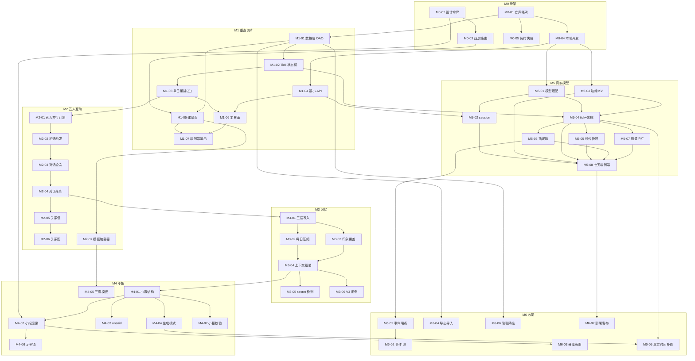

# AI小镇 · 任务分解（task.md）

> 版本 v1.6 ｜ 2026-11-13 ｜ 依据 `docs/spcd.md` v1.2
> 原则：**只实现 SPCD 已定义的内容，不新增功能**。任何任务若需要超出 SPCD 的行为，必须先在 SPCD 补章节。
> v1.1 状态回写：M0–M6 代码与本地用例已完成；模板端点已补齐（P0-1）；preview 部署因缺外部凭据阻塞（P0-2）；真实模型复测待部署后执行。任务状态见 §9。
> v1.2 状态回写：§12.3 剧情质量规则项已自动化（`tests/contract/quality.test.js`），记录见 §9.5。
> v1.3 状态回写：三套模板文案与示例小镇数据说明已独立成文（`docs/data.md`）。
> v1.4 状态回写：M6-07 已完成，preview 上线（Pages + Worker + Pages Functions 同源代理），`smoke:remote` 通过，见 §9.4。
> v1.5 状态回写：真实模型 3×7 远端用例通过，M5-02 / M5-08 完成，V1/V4/V5 指标见 §9.1。
> v1.6 状态回写：§12.3 主观评审完成首轮（3/3「能看」），并修复 C5 词表误伤，见 §9.5。

---

## 0. 使用说明

### 0.1 任务粒度约定

一个任务必须满足三条：**可独立开始、可独立完成、可独立验证**。凡是不满足的，需要继续拆分。

禁止出现「实现整个后端」「完成前端」这类任务。

### 0.2 优先级定义

| 优先级 | 含义 | 处理方式 |
|---|---|---|
| P0 | 主链路阻塞，缺它后续无法开始 | 必须完成，不可跳过 |
| P1 | 所属里程碑的必需项 | 必须完成，可调顺序 |
| P2 | 增强项，不影响里程碑通过 | 可后置，可降级交付 |

### 0.3 验证命令约定

所有验证通过 `package.json` 的 npm scripts 执行，不依赖临时命令：

| 脚本 | 作用 |
|---|---|
| `npm run dev` | 同时启动静态服务与函数本地运行时 |
| `npm run check:structure` | 校验目录结构与 SPCD §5 一致 |
| `npm run check:tokens` | 校验样式令牌完整、无硬编码色值 |
| `npm run test:unit` | 单元测试（Vitest） |
| `npm run test:contract` | 契约测试（schema 与快照） |
| `npm run test:integration` | 集成测试（桩模型 / 本地 KV） |
| `npm run test:e2e` | 端到端测试（Playwright） |
| `npm run smoke` | 本地冒烟 |
| `npm run smoke:remote` | 远端冒烟 |
| `npm run deploy:preview` | 发布到 preview 环境 |

`-- --grep <关键词>` 用于只跑某一组用例。

### 0.4 分工假设

单人全栈开发。任务标注的可并行轨道用于**排期穿插**，不代表多人并行。

---

## 1. 任务树总览

| 里程碑 | 任务数 | 主题 | 状态 |
|---|---|---|---|
| M0 | 5 | 骨架与设计令牌 | 已完成 |
| M1 | 7 | 垂直切片（1 居民 1 天，桩模型） | 已完成 |
| M2 | 7 | 五人互动 | 已完成 |
| M3 | 6 | 记忆分层与关系 | 已完成 |
| M4 | 7 | 小报 | 已完成 |
| M5 | 8 | 真实模型与流式 | 已完成 |
| M6 | 7 | 事件、分享、导出、补算 | 已完成 |
| 合计 | 47 | | |

---

## 2. 任务依赖图

---

## 3. 可并行轨道

| 轨道 | 任务序列 | 说明 |
|---|---|---|
| A 数据/领域 | M1-01 → M1-02 → M1-03 → M2-01…M2-05 → M3-01…M3-04 | 纯逻辑，可脱离网络与 UI 独立测试 |
| B 前端界面 | M0-02 → M0-03 → M1-05 → M1-06 → M2-06 → M4-02 → M4-06 → M6-02 → M6-03 | 只依赖契约，不依赖真实模型 |
| C 服务端 | M0-04 → M1-04 → M5-01 → M5-03 → M5-04 → M5-06 → M6-01 → M6-07 | 可在桩上游上先跑通 |
| D 测试/验收 | M0-05 → M3-06 → M4-07 → M5-08 → M6-04 | 贯穿全程，负责每个里程碑的门槛判定 |

**合流点**：M1-07（垂直切片验收）。M1 之前四轨并行推进，M1-07 之后 A/B/C 再次分叉。

---

## 4. 任务详情

### M0 骨架

#### M0-01 仓库骨架与契约目录
- **优先级**：P0
- **目标**：按 SPCD §5 建立完整目录树；建立 `shared/contracts` 空 schema 与 `shared/errors` 码表；在 `package.json` 中定义 §0.3 全部脚本
- **产出**：`/` 目录树、`shared/contracts/index.js`、`shared/errors/codes.js`、`package.json`、`scripts/check-structure.mjs`
- **依赖**：无
- **验收标准**：目录结构与 §5 逐条一致；`codes.js` 覆盖 SPCD §7.5 的 12 个错误码与 5 个告警码
- **验证命令**：`npm run check:structure`

#### M0-02 设计令牌与基础样式
- **优先级**：P0
- **目标**：建立颜色、字号、间距、圆角、阴影五组令牌与基础重置样式
- **产出**：`web/styles/tokens.css`、`web/styles/base.css`
- **依赖**：无
- **验收标准**：只有 `tokens.css` 允许出现色值；`base.css` 全部引用变量；提供 375 / 768 / 1280 三个断点
- **验证命令**：`npm run check:tokens`

#### M0-03 四屏路由骨架
- **优先级**：P0
- **目标**：首页、建镇、主界面、年报四屏可导航，刷新后停留在当前屏
- **产出**：`web/index.html`、`web/app/router.js`、`web/app/screens/{home,create,town,year}.js`
- **依赖**：M0-02
- **验收标准**：四屏可互相跳转；无控制台报错；每屏有可识别的占位内容
- **验证命令**：`npm run test:e2e -- --grep "路由"`

#### M0-04 本地开发与冒烟脚本
- **优先级**：P0
- **目标**：一条命令同时起静态服务与函数本地运行时，并本地模拟边缘 KV
- **产出**：`scripts/dev-server.mjs`、`wrangler.toml` 或等价本地配置、`scripts/smoke.mjs`
- **依赖**：M0-01
- **验收标准**：`npm run dev` 后静态与函数均可访问；本地 KV 读写可用；`npm run smoke` 通过
- **验证命令**：`npm run dev` 后另开终端 `npm run smoke`

#### M0-05 契约快照测试骨架
- **优先级**：P1
- **目标**：对 `shared/contracts` 建立快照基线，契约变更时测试失败
- **产出**：`tests/contract/contracts.snapshot.test.js`、快照文件
- **依赖**：M0-01
- **验收标准**：首次运行生成快照；人为改字段后测试失败
- **验证命令**：`npm run test:contract`

---

### M1 垂直切片（1 居民 1 天，桩模型）

> 本里程碑用 1 个居民简化开发，临时偏离 C1，由 M2-01 补齐。这是刻意的切片，不是缺陷。

#### M1-01 数据层 schema 与 DAO
- **优先级**：P0
- **目标**：实现 SPCD §6 的 11 张表、10 个索引与级联删除
- **产出**：`web/infra/storage/idb.js`、`web/infra/storage/dao.js`、`tests/unit/storage/*.test.js`
- **依赖**：M0-01
- **验收标准**：表与索引与 §6.2/§6.3 一致；C1、C2、C8 在 DAO 层拒绝非法写入；删除小镇后子表数据为 0
- **验证命令**：`npm run test:unit -- --grep "storage"`

#### M1-02 Tick 状态机
- **优先级**：P0
- **目标**：实现 SPCD §8.2 的九态迁移与 `DAY_STATE.status` 映射
- **产出**：`web/domain/simulation/tickMachine.js`、`tests/unit/simulation/tick-machine.test.js`
- **依赖**：M1-01
- **验收标准**：全部合法迁移可达；全部非法迁移抛 `E_TOWN_STATE`；`degraded → reporting` 可达
- **验证命令**：`npm run test:unit -- --grep "tick-machine"`

#### M1-03 单日编排（桩模型）
- **优先级**：P0
- **目标**：1 个居民走完计划 → 行动 → 独白，全流程不触网
- **产出**：`web/domain/simulation/day.js`、`web/domain/agent/plan.js`、`tests/integration/day-stub.test.js`
- **依赖**：M1-02
- **验收标准**：产出 1 条计划与 1 条独白；状态机停在 `done`；全程无网络请求
- **验证命令**：`npm run test:integration -- --grep "day-stub"`

#### M1-04 最小 API
- **优先级**：P0
- **目标**：实现 `/v1/health` 与桩版 `/v1/session`，统一错误结构
- **产出**：`functions/health/index.js`、`functions/session/index.js`
- **依赖**：M0-04
- **验收标准**：health 返回 `ok/model_reachable/latency_ms`；session 返回 `session_token/expires_at`；错误体符合 §7.1
- **验证命令**：`npm run smoke -- --grep "api"`

#### M1-05 建镇页
- **优先级**：P0
- **目标**：选模板 → 查看并编辑 5 个居民 → 开始，写入 TOWN 与 AGENT
- **产出**：`web/app/screens/create.js`、`data/templates/seaside.json`（临时单套）
- **依赖**：M0-03、M1-01
- **验收标准**：可切换模板；可修改 5 个字段；开始后 TOWN.status=`running`、day_index=0；不足 5 人时禁止保存（C1）
- **验证命令**：`npm run test:e2e -- --grep "建镇"`

#### M1-06 主界面最小版
- **优先级**：P0
- **目标**：提供「过一天」按钮与五阶段进度展示
- **产出**：`web/app/screens/town.js`、`web/ui/progress.js`
- **依赖**：M1-03、M1-04
- **验收标准**：点击后依次显示 validating/planning/simulating/reflecting/reporting；完成态显示 `done`；重复点击提示进行中
- **验证命令**：`npm run test:e2e -- --grep "主界面"`

#### M1-07 端到端演示
- **优先级**：P0
- **目标**：打通「建镇 → 跑 1 天 → 展示结果」的最小闭环
- **产出**：`tests/e2e/vertical-slice.spec.js`
- **依赖**：M1-05、M1-06
- **验收标准**：一次运行完成闭环；刷新页面后数据仍在；无控制台错误
- **验证命令**：`npm run test:e2e -- --grep "vertical-slice"`

---

### M2 五人互动

#### M2-01 五人并行计划
- **优先级**：P0
- **目标**：5 个居民并行生成当日计划，单点失败可降级
- **产出**：`web/domain/agent/plan.js`（扩展）、`tests/unit/agent/plan-parallel.test.js`
- **依赖**：M1-03
- **验收标准**：5 条计划并发发起；单条失败重试 1 次后使用模板计划并记 `W_STAGE_DEGRADED`；最终必得 5 条
- **验证命令**：`npm run test:unit -- --grep "plan-parallel"`

#### M2-02 位置推进与相遇触发
- **优先级**：P0
- **目标**：按小时写 `current_location`，同地点触发相遇，单小时上限 2 段
- **产出**：`web/domain/simulation/encounter.js`
- **依赖**：M2-01
- **验收标准**：同地点 ≥2 人产生一次相遇；同小时第 3 段起记为「擦肩而过」写入事件层
- **验证命令**：`npm run test:unit -- --grep "encounter"`

#### M2-03 对话生成与轮次控制
- **优先级**：P0
- **目标**：由先到者发起对话，最多 6 轮，transcript 结构固定
- **产出**：`web/domain/simulation/dialogue.js`
- **依赖**：M2-02
- **验收标准**：轮次 ≤6；超限自然中断；transcript 每轮含说话人与内容
- **验证命令**：`npm run test:unit -- --grep "dialogue"`

#### M2-04 对话落库与事件层记忆
- **优先级**：P0
- **目标**：对话写入 DIALOGUE，并为双方各写 1 条 event 记忆
- **产出**：`web/domain/memory/tier.js`（仅 event 层）、DAO 扩展
- **依赖**：M2-03
- **验收标准**：每段对话产生 2 条 event 记忆；`expire_day = created_day`
- **验证命令**：`npm run test:integration -- --grep "dialogue-persist"`

#### M2-05 关系值规则
- **优先级**：P0
- **目标**：实现 §8.5 的增减规则、标签映射与单日封顶
- **产出**：`web/domain/relation/rules.js`、`web/domain/relation/label.js`
- **依赖**：M2-04
- **验收标准**：按初始值更新；单日单对变化 ≤±8；三天无互动衰减 1 点；标签映射与 §8.5 一致
- **验证命令**：`npm run test:unit -- --grep "relation"`

#### M2-06 关系图最小可视化
- **优先级**：P1
- **目标**：展示 5 节点与有向关系边
- **产出**：`web/ui/relationGraph.js`
- **依赖**：M2-05
- **验收标准**：熟/生/有结三态可辨；每个节点与边有可读文本替代
- **验证命令**：`npm run test:e2e -- --grep "关系图"`

#### M2-07 模板契约与加载器
- **优先级**：P1
- **目标**：实现 §7.4 的模板结构校验与加载，先落 1 套真实模板
- **产出**：`shared/contracts/template.js`、`web/infra/api/templates.js`、`functions/templates/index.js`、`data/templates/*.json`
- **依赖**：M1-05
- **验收标准**：模板必须 5 人；字段完整；不合规返回 `E_VALIDATION`；无真实个人信息
- **验证命令**：`npm run test:contract -- --grep "template"`

---

### M3 记忆分层与关系

#### M3-01 记忆三层写入规则
- **优先级**：P0
- **目标**：实现 event/summary/impression 三层各自的字段约束与写入条件
- **产出**：`web/domain/memory/tier.js`（完整）
- **依赖**：M2-04
- **验收标准**：三层长度上限生效；`impression` 必须带 `target_agent_id`；非法写入被拒
- **验证命令**：`npm run test:unit -- --grep "memory-tier"`

#### M3-02 每日压缩
- **优先级**：P0
- **目标**：当天结束后把 event 压成 1 条 summary 并删除原文
- **产出**：`web/domain/memory/compress.js`
- **依赖**：M3-01
- **验收标准**：每天恰生成 1 条 summary（≤80 字）；当日 event 记录数为 0；history 仍可读
- **验证命令**：`npm run test:unit -- --grep "compress"`

#### M3-03 印象层覆盖更新
- **优先级**：P0
- **目标**：同一 target 只保留 1 条印象（C4）
- **产出**：`web/domain/memory/impression.js`
- **依赖**：M3-01
- **验收标准**：重复写入后条数不变；内容为新值
- **验证命令**：`npm run test:unit -- --grep "impression"`

#### M3-04 上下文组装与截断
- **优先级**：P0
- **目标**：按 §8.6 优先级组装 tick 上下文，超限按规则截断
- **产出**：`web/domain/memory/assemble.js`、`shared/contracts/tick-context.js`
- **依赖**：M3-02、M3-03
- **验收标准**：输出符合 §7.3 schema；超 6000 token 先丢 3 天前 summary，再丢非在场者印象；K1–K6 可复用校验
- **验证命令**：`npm run test:contract -- --grep "tick-context"`

#### M3-05 secret 三级检测
- **优先级**：P0
- **目标**：实现 C5 的词表 → 语义 → 重写三级流程
- **产出**：`web/domain/memory/secretGuard.js`
- **依赖**：M3-04
- **验收标准**：词表命中即拦截；命中后重写 1 次；仍命中则整句替换；泄露判定次数写入 USAGE
- **验证命令**：`npm run test:unit -- --grep "secret-guard"`

#### M3-06 V3 验证用例
- **优先级**：P1
- **目标**：验证第 1 天细节能在第 5 天被正确引用，不依赖任何对话接口
- **产出**：`tests/integration/v3-recall.test.js`
- **依赖**：M3-04
- **验收标准**：注入细节后，第 5 天产物文本出现该细节的正确引用；断言只检查文本，不涉及问答
- **验证命令**：`npm run test:integration -- --grep "v3-recall"`

---

### M4 小报

#### M4-01 小报结构与生成
- **优先级**：P0
- **目标**：生成四类 section 的小报并落库
- **产出**：`web/domain/report/structure.js`、`web/domain/report/builder.js`、`shared/contracts/report.js`
- **依赖**：M3-04
- **验收标准**：section kind ∈ 四类；每天 1 份；`(town_id, day)` 唯一冲突时报错
- **验证命令**：`npm run test:unit -- --grep "report-structure"`

#### M4-02 小报渲染与版式
- **优先级**：P0
- **目标**：把四类 section 渲染为固定版式页面
- **产出**：`web/ui/report.js`、`web/styles/report.css`
- **依赖**：M4-01、M0-02
- **验收标准**：四类 section 正确渲染；375px 无横向溢出；存在截图基线
- **验证命令**：`npm run test:e2e -- --grep "report-render"`

#### M4-03 unsaid 与 C6
- **优先级**：P0
- **目标**：保证每份小报固定 5 条 unsaid
- **产出**：`web/domain/report/unsay.js`
- **依赖**：M4-01
- **验收标准**：5 条与 5 人一一对应；缺失重建最多 2 次；仍缺失则 `generation_mode=degraded`
- **验证命令**：`npm run test:unit -- --grep "unsay"`

#### M4-04 生成模式三态
- **优先级**：P1
- **目标**：支持 normal / backfill / degraded 三态写入与读取
- **产出**：`web/domain/report/builder.js`（扩展）
- **依赖**：M4-01
- **验收标准**：三态可写入、可查询、页面可区分展示
- **验证命令**：`npm run test:unit -- --grep "generation-mode"`

#### M4-05 三套模板定稿
- **优先级**：P1
- **目标**：完成海边小镇、大学城后街、老城区拆迁楼三套模板，各 5 个居民
- **产出**：`data/templates/{seaside,campus,demolition}.json`
- **依赖**：M2-07
- **验收标准**：三套各 5 人；字段完整；`name` 模板内唯一；无真实个人信息；符合 §7.4
- **验证命令**：`npm run test:contract -- --grep "templates-all"`

#### M4-06 示例小镇与预渲染页
- **优先级**：P1
- **目标**：内置一座 7 天完整示例镇，首页零成本可看（V8）
- **产出**：`data/sample-town/town.json`、`data/sample-town/reports/*.json`、首页接入
- **依赖**：M4-02
- **验收标准**：断网可完整浏览 7 天；模型调用计数为 0；分享按钮可用
- **验证命令**：`npm run test:e2e -- --grep "sample-town-offline"`

#### M4-07 小报结构校验测试
- **优先级**：P1
- **目标**：为小报结构建立契约测试，覆盖 V2
- **产出**：`tests/contract/report.test.js`
- **依赖**：M4-01
- **验收标准**：结构不合规时用例失败；覆盖四类 section 与 5 条 unsaid
- **验证命令**：`npm run test:contract -- --grep "report"`

---

### M5 真实模型与流式

#### M5-01 模型适配层
- **优先级**：P0
- **目标**：封装 OpenAI 兼容调用，统一超时、重试、结构化解析与日志脱敏
- **产出**：`functions/model/index.js`
- **依赖**：M0-04
- **验收标准**：超时与重试可配置；解析失败返回 `E_MODEL_OUTPUT`；日志中 `api_key` 恒为脱敏值
- **验证命令**：`npm run test:integration -- --grep "model-adapter"`

#### M5-02 session 真实实现
- **优先级**：P0
- **目标**：真实校验 Key，签发 token，Key 仅在内存驻留
- **产出**：`functions/session/index.js`
- **依赖**：M1-04、M5-01
- **验收标准**：无效 Key 返回 `E_KEY_INVALID`；有效返回 `session_token/expires_at`；TTL 2 小时；销毁后立即失效
- **验证命令**：`npm run smoke -- --grep "session-live"`

#### M5-03 边缘 KV 适配
- **优先级**：P0
- **目标**：实现 tick 占位、限流计数、幂等键、会话索引
- **产出**：`functions/runtime/kv.js`
- **依赖**：M0-04
- **验收标准**：占位 TTL 600 秒；限流 6 次/分；幂等键 24 小时；会话索引仅存加密引用
- **验证命令**：`npm run test:integration -- --grep "kv"`

#### M5-04 tick 端点与 SSE
- **优先级**：P0
- **目标**：实现 §7.2 端点 5 与 §7.6 全部帧类型
- **产出**：`functions/tick/index.js`、`web/infra/api/sse.js`
- **依赖**：M5-01、M5-03、M1-02
- **验收标准**：帧类型齐全；响应头含 `no-store` 与 `X-Accel-Buffering: no`；并发第二次返回 `E_TICK_IN_FLIGHT`；前端用 fetch 读取，禁用 EventSource
- **验证命令**：`npm run test:integration -- --grep "tick-sse"`

#### M5-05 续传与快照
- **优先级**：P1
- **目标**：支持 `Last-Event-ID` 重连与阶段结果快照
- **产出**：`functions/tick/index.js`（扩展）、`web/infra/api/sse.js`（扩展）
- **依赖**：M5-04
- **验收标准**：断流后携 ID 重连可补齐；已完成阶段不重复调用模型；快照 TTL 10 分钟
- **验证命令**：`npm run test:integration -- --grep "resume"`

#### M5-06 错误码与告警码全量
- **优先级**：P0
- **目标**：落地 §7.5 全部错误码与告警码
- **产出**：`functions/guard/*`、`shared/errors/codes.js`（完善）
- **依赖**：M5-04
- **验收标准**：12 个错误码与 5 个告警码均可被构造触发；warning 帧不关闭流
- **验证命令**：`npm run test:contract -- --grep "error-codes"`

#### M5-07 用量计量与成本护栏
- **优先级**：P0
- **目标**：每次模型调用写 USAGE，累计超 5 元时降级
- **产出**：`functions/tick/index.js`（计量与护栏）
- **依赖**：M5-04
- **验收标准**：每次调用 1 条 USAGE；折算超限发 `W_BUDGET_GUARD` 并降级但不中断
- **验证命令**：`npm run test:integration -- --grep "budget-guard"`

#### M5-08 七天真实端到端
- **优先级**：P0
- **目标**：真实模型跑通完整七天并输出指标
- **产出**：`tests/e2e/seven-days.spec.js`、`scripts/metrics.mjs`
- **依赖**：M5-02 ～ M5-07
- **验收标准**：V1 连续 3 次通过；V4 P95 ≤150 秒；V5 ≤5 元；输出指标报告文件
- **验证命令**：`npm run test:e2e -- --grep "seven-days"`

---

### M6 事件、分享、导出、补算

#### M6-01 事件端点与校验
- **优先级**：P0
- **目标**：实现 §7.2 端点 6 与 §7.7 全部约束
- **产出**：`functions/events/index.js`、`functions/guard/content.js`
- **依赖**：M5-06
- **验收标准**：类型白名单生效；每天 1 条（C3）；含指令性内容返回 `E_VALIDATION`；命中安全规则返回 `E_CONTENT_BLOCKED`
- **验证命令**：`npm run test:integration -- --grep "events"`

#### M6-02 事件 UI
- **优先级**：P1
- **目标**：在主界面提供事件提交与当天已提交状态展示
- **产出**：`web/ui/eventComposer.js`、`web/app/screens/town.js`（接入）
- **依赖**：M6-01
- **验收标准**：每天只能提交 1 次；已提交后输入禁用；提交后回显事件内容
- **验证命令**：`npm run test:e2e -- --grep "event-ui"`

#### M6-03 分享长图
- **优先级**：P1
- **目标**：前端生成分享长图（V7），使用系统字体，不引用跨域资源
- **产出**：`web/infra/share/index.js`
- **依赖**：M4-02
- **验收标准**：导出 PNG；含小镇名与日期；移动端可正常显示；全程无服务端出图请求
- **验证命令**：`npm run test:e2e -- --grep "share-image"`

#### M6-04 导出与导入
- **优先级**：P1
- **目标**：实现 `town.json` 与 `town.md` 导出，以及 JSON 回导
- **产出**：`web/infra/storage/export.js`
- **依赖**：M1-01
- **验收标准**：导出含全部表与 `schema_version`；回导后可从当前天继续推进；`town.md` 无数据结构痕迹、可读
- **验证命令**：`npm run test:integration -- --grep "export-import"`

#### M6-05 真实时间补算
- **优先级**：P0
- **目标**：实现 §8.8 的补算流程，单批上限 2 天，可中断续算
- **产出**：`web/domain/simulation/backfill.js`
- **依赖**：M5-04、M4-04
- **验收标准**：单批 ≤2 天；每天完成即落盘并渲染；超出发 `W_BACKFILL_CAPPED`；中断后下次继续剩余天数
- **验证命令**：`npm run test:integration -- --grep "backfill"`

#### M6-06 隐私模式降级
- **优先级**：P2
- **目标**：IndexedDB 不可用时降级到内存并明确提示
- **产出**：`web/infra/storage/memoryFallback.js`
- **依赖**：M1-01
- **验收标准**：模拟 IDB 不可用后功能仍可运行；页面常驻提示「刷新即丢失」
- **验证命令**：`npm run test:e2e -- --grep "private-mode"`

#### M6-07 部署与版本校验
- **优先级**：P0
- **目标**：完成静态与函数分别发布，前端启动校验版本兼容
- **产出**：`scripts/deploy.mjs`、环境配置、`/v1/health` 增加版本字段
- **依赖**：M5-08
- **验收标准**：preview 环境可访问；版本不兼容时前端给出明确提示；远端冒烟通过
- **验证命令**：`npm run deploy:preview && npm run smoke:remote`

---

## 5. 里程碑通过门槛

| 里程碑 | 通过条件（全部满足才算通过） | 判定命令 |
|---|---|---|
| M0 | 目录结构校验通过；四屏可导航；`npm run dev` + `npm run smoke` 成功 | `npm run check:structure && npm run test:e2e -- --grep "路由"` |
| M1 | 垂直切片端到端用例通过；Tick 状态机单测全绿；刷新不丢数据 | `npm run test:e2e -- --grep "vertical-slice"` |
| M2 | 5 人同行一天可跑完；对话与关系落库正确；C1/C8 单测通过 | `npm run test:unit -- --grep "relation" && npm run test:integration -- --grep "dialogue-persist"` |
| M3 | V3 用例通过；压缩后当日 event 归零；secret 检测三级均可触发 | `npm run test:integration -- --grep "v3-recall"` |
| M4 | 7 天各出一份合规小报；示例镇断网可看；V2 通过 | `npm run test:contract -- --grep "report" && npm run test:e2e -- --grep "sample-town-offline"` |
| M5 | V1/V4/V5 达标；断流可续传；12 个错误码全部可触发 | `npm run test:e2e -- --grep "seven-days"` |
| M6 | V6/V7/V8 达标；导出可回导；补算可中断续算；远端冒烟通过 | `npm run smoke:remote && npm run test:integration -- --grep "backfill"` |

---

## 6. 最终验收清单

### 6.1 后端

- [x] 全部 7 个端点行为符合 SPCD §7.2（模板端点 3 / 4 于 2026-11-12 补齐，契约用例与本地冒烟通过）
- [x] Tick 上下文通过 K1–K6 校验（§7.3）
- [x] 12 个错误码 + 5 个告警码全部可触发（§7.5；`tests/contract/error-codes.test.js`）
- [x] SSE 使用 fetch 流式，未使用 EventSource；响应头含 `no-store` 与 `X-Accel-Buffering: no`
- [x] `Last-Event-ID` 续传可用，已完成阶段不重复调用模型
- [x] Key 仅内存驻留；日志与 KV 中无明文 Key
- [x] 边缘 KV 四类键均按 TTL 生效
- [x] 单局成本 ≤5 元；超限可降级且不中断（真实模型 3×7：`max_run_cost_yuan=0.050268`，总成本 0.138821 元，`test-results/metrics.json`）

### 6.2 前端

- [x] 四屏可用，移动端 375px 无横向溢出
- [x] 建镇页支持模板切换与 5 人编辑，不足 5 人禁止保存
- [x] 主界面可推进、可投递事件（每天 1 条）、可看关系图
- [x] 小报四类 section 渲染正确，5 条 unsaid 齐全
- [x] 分享长图可导出并可在移动端显示（导出 e2e 通过；真机显示列入发布后人工核验）
- [x] 导出 `town.json` / `town.md` 可用，JSON 可回导续玩
- [x] 示例镇断网可完整浏览，模型调用为 0
- [x] 隐私模式下自动降级并提示

### 6.3 测试

- [x] 单元测试覆盖 C1–C9 全部约束的负向用例
- [x] 契约测试覆盖全部端点、上下文、模板与小报结构，含快照（含模板端点 5 条）
- [x] 集成测试覆盖 tick 全链路、续传、护栏、补算、导出回导
- [x] 端到端覆盖垂直切片、七天真实跑通、示例镇离线（真实模型 3×7 连续通过，P95 13.1 秒）
- [x] 剧情质量规则项自动可跑；主观项完成首轮记录（3/3「能看」，见 §9.5）

### 6.4 文档

- [x] `docs/spcd.md` 与实际实现一致，偏差已回写（v1.2 附录 C）
- [x] `docs/task.md` 全部任务状态为完成（47/47）
- [x] 示例小镇与三套模板的数据说明齐备（结构见 spcd §7.4 / 附录 C；模板文案与示例数据说明见 `docs/data.md`）
- [x] 提交材料：README、图文教程、创作说明（`README.md` / `docs/showcase/tutorial.html` / `docs/submission.md`）
- [x] 附录 B 的待确认项均有结论或明确遗留说明

---

## 7. 风险与回退方案

| 编号 | 风险 | 触发信号 | 回退方案 |
|---|---|---|---|
| T1 | 模型 JSON 输出不稳定，解析失败率高 | `E_MODEL_OUTPUT` 占比超阈值 | 收紧输出约束模板；解析失败改为一次重写；仍失败走兜底结构，不阻塞当天 |
| T2 | 单次 Tick 超时（>150 秒） | V4 连续不达标 | 下调对话轮次上限；减少同小时相遇数；必要时把 tick 拆为两个流式批次 |
| T3 | 单局成本超 5 元 | V5 不达标 | 加强压缩、缩短上下文、优先使用短模型调用；护栏阈值下调 |
| T4 | 边缘 KV 平台限制或额度不足 | 限流失效或写入报错 | 回退到「仅前端串行 + 无服务端限流」，接受代理滥用风险，并缩短会话 TTL |
| T5 | 原生无构建前端变得难以维护 | 模块循环依赖、契约漂移 | 保留 `shared/contracts` 作为唯一事实源；若仍失控，再评估引入构建工具（需先改 SPCD） |
| T6 | 真实时间补算体验差 | 用户打开即长时间等待 | 单批上限从 2 天下调到 1 天；改为「点击继续」而非自动串行 |
| T7 | 隐私模式覆盖率高 | 数据丢失反馈集中 | 首屏提示改为强提示；导出入口前置到主界面 |
| T8 | 剧情质量不达标（无聊/崩坏） | 主观评审连续两轮「能看」以下 | 强化 `secret` 与 `conflict_goal`；限制单日关系变化幅度至 ±5；增加零信息对话的拦截规则 |

**回退原则**

1. 任何回退都不得突破 SPCD §1.4 的非目标
2. 回退若改变了契约，必须先改 SPCD，再改实现，不允许实现先跑偏
3. 每个里程碑的产物在下一个里程碑开始前可独立运行，保证任意时点都能停在一个可用状态

---

## 8. 与 SPCD 待确认项的映射

| SPCD 项 | 影响任务 | 当前处理 |
|---|---|---|
| Q1 单次 Tick 等待上限 | M5-04、M5-08 | 暂按 150 秒设计，实测后调整 |
| Q2 免费额度 | M5-03、M6-07 | 先按平台默认额度开发，发布前测算 |
| Q3 三套模板 | M4-05 | **已解决**：海边小镇 / 大学城后街 / 老城区拆迁楼 |
| Q4 分享图版式 | M6-03 | 先做基础版式，样式后续迭代 |
| Q5 日志保留期 | — | 不阻塞任务，发布前确定 |
| Q6 平台选型 | M6-07 | 默认按 Cloudflare 实现，适配层隔离 |
| Q7 内容抽检 | M5-08 | 暂不设置，主观评审代替 |

Q1、Q2 仍是唯一可能影响里程碑门槛的外部变量。

---

## 9. 任务状态与阻塞项（2026-11-12）

### 9.1 状态口径

| 状态 | 含义 |
|---|---|
| 已完成 | 代码落地，且 `check:structure` / `check:tokens` / `test:unit` / `test:contract` / `test:integration` / 本地 `smoke` 至少一条相关用例通过 |
| 待复测 | 本地桩链路通过，真实模型或远端环境尚未验证 |
| 阻塞 | 依赖外部凭据，无法在本地完成 |

最近一次本地验证：`check:structure`、`check:tokens`、`test:contract`（52 条）、`test:unit`（92 条）、`test:integration`（61 条）全部通过；`test:e2e` 18 条全量通过。
2026-11-13 preview 部署完成：`npm run deploy:preview && npm run smoke:remote` 通过（`/v1/health` version 1.0.0）。
2026-11-13 真实模型远端验证：`E2E_REMOTE=1 npm run test:e2e -- --grep "seven-days"` 3×7 通过；V1 3/3、V4 P95 13135ms、V5 单轮最高 0.050268 元（`test-results/metrics.json`）。
2026-11-13 主观评审：海边小镇模板 3 局×7 天，3/3「能看」（§9.5）。

### 9.2 里程碑状态

| 里程碑 | 状态 | 依据 |
|---|---|---|
| M0 | 已完成 | 目录与令牌校验通过；四屏路由 e2e 通过 |
| M1 | 已完成 | tick-machine 单测、day-stub 集成、vertical-slice e2e 通过 |
| M2 | 已完成 | plan-parallel / encounter / dialogue / relation 用例通过 |
| M3 | 已完成 | memory-tier / compress / impression / secret-guard / v3-recall 通过 |
| M4 | 已完成 | 小报契约与渲染 e2e、示例镇离线 e2e 通过 |
| M5 | 已完成 | 模型适配、SSE、续传、错误码、护栏本地用例通过；真实 Key 校验与 3×7 真实模型远端用例通过 |
| M6 | 已完成 | 事件、分享长图、导出回导、补算完成；M6-07 preview 上线，`smoke:remote` 通过 |

### 9.3 逐项例外

| 任务 | 状态 | 说明 |
|---|---|---|
| M5-02 session 真实实现 | 已完成 | 真实 DeepSeek Key 在 preview 校验通过；session 返回 200，TTL 2 小时 |
| M5-08 七天真实端到端 | 已完成 | 真实模型 3×7 通过：V1 3/3、P95 13135ms、单轮最高 0.050268 元（`test-results/metrics.json`） |
| M6-07 部署与版本校验 | 已完成 | 2026-11-13 preview 上线：https://preview.ai-town-5ts.pages.dev；`npm run deploy:preview && npm run smoke:remote` 通过 |

### 9.4 部署记录（原 P0-2，已解决）

2026-11-13 完成 preview 部署，`smoke:remote` 通过。部署形态与资源如下（不含任何密钥）：

| 项目 | 值 |
|---|---|
| 静态站（Pages） | `ai-town` → https://preview.ai-town-5ts.pages.dev |
| API（Worker） | `ai-town-api-preview` → https://ai-town-api-preview.ai-town-7e28.workers.dev |
| 同源入口 | Pages Functions `functions/v1/[[path]].js` 把 `/v1/*` 代理到 Worker |
| KV（preview） | `f136bdf91fde449bb2d749f72dc0ea4d` |
| KV（production） | `37b2a877d7144bd2861e7f0e1b0b983d` |
| 版本 | `/v1/health` → `1.0.0`，`model_reachable=true` |
| 真实模型验证 | 3×7 通过：21 个 tick、285 次模型调用、总成本 0.138821 元（`test-results/metrics.json`） |

复现命令：`npm run deploy:preview && npm run smoke:remote`。真实模型复测：`E2E_REMOTE=1 E2E_BASE_URL=https://preview.ai-town-5ts.pages.dev npm run test:e2e -- --grep "seven-days"`（`DEEPSEEK_API_KEY` 从本地 `.env.local` 读取）。凭据只存放在本地 `.env.local`（已 gitignore），未写入仓库。

真实模型七天用例已于 2026-11-13 完成；后续迭代按 §12.3 主观评审流程执行。

### 9.5 剧情质量评测记录（§12.3）

**规则项（自动）**：`tests/contract/quality.test.js` 4 条用例通过（2026-11-13）。判定逻辑在 `tests/support/quality.js`，不参与运行时链路。

| 规则 | 判定方式 | 覆盖 |
|---|---|---|
| 零信息开场 | 去掉标点与问候/寒暄用语后无剩余内容即零信息；超过 2 次判失败样本 | 正负向用例各 2 组 |
| 每份小报 ≥1 条关系变化 | 关系版块须含 `x → y` 的数值变化（含负值） | 示例小镇 7 天逐日校验 |
| 5 条 unsaid 各不相同且含细节 | 长度 ≥15 字且含专有名词 | 示例小镇 7 天逐日校验；缺条、重复、过短、无名词均有负向用例 |

**主观项（人工）**：2026-11-13 完成首轮。样本为海边小镇模板 3 局 × 7 天，真实模型，局内记忆与关系连续；评审包见 `test-results/quality-review-real/summary.md`。

| 局 | 评分 | 观察 |
|---|---|---|
| 第 1 局 | 能看 | 以菜市场为主，林小满/周秀兰高频 |
| 第 2 局 | 能看 | 周秀兰与阿彪、苗苗的线更完整 |
| 第 3 局 | 能看 | 第 3 天无人碰面，仍以菜市场对话为主 |

结论：3/3「能看」，未达「想看下一集」。主要短板是场景与人物组合重复、头条句式单一。

**评审中发现并修复**：C5 词表原先把 secret 的 2 字碎片（如「人的」「一个」「故事」）都当作敏感词，正常对话被大量替换成「……」。现已收紧为 5 字以上短语 + 专名/数量词，并补回归用例（`tests/unit/memory/secret-guard.test.js`）；重跑 3 局后文本恢复正常。
